# sub2api-next 架构设计

> 状态：现行，随代码维护（生产运行中，核心 0.1.x）。与代码冲突时以代码为准并改正本文；接口与行为约定以 [CONTRACTS.md](CONTRACTS.md) 为准。§1、§17 记录的是初始版本的范围与实施计划，§18 是决策记录，现状以 §2–§16 为准。
> 目标：基于"用户 / 角色 / 权限 + 插件"的架构，重写一个全新的服务。旧代码保留，仅作参考。

---

## 0. 阅读指引

| 章节 | 内容 |
|---|---|
| 1 | 初始版本做什么、不做什么 |
| 2 | 部署架构、节点内部架构、多节点协作（**节点架构图**） |
| 3 | 核心与插件的划分 |
| 4 | 数据模型 |
| 5 | 插件系统：插件包、manifest、gRPC 契约、生命周期、授权确认、数据库 schema 与迁移、多节点发布 |
| 6 | 网关：请求流水线、调度、钩子 |
| 7 | 分组、计费与余额 |
| 8 | 插件后台任务与事件订阅 |
| 9 | 插件网络：出口隧道与严格模式 |
| 10 | 插件资源限制 |
| 11 | 插件签名、信任与插件市场 |
| 12 | 前端：控制台、插件界面（iframe / 原生微前端） |
| 13 | 用户 / 角色 / 权限 |
| 14 | 其他关键流程：账号录入、插件安装 |
| 15 | 两个演示插件：anthropic、guard |
| 16 | 代码仓库结构与技术选型 |
| 17 | 实施计划、Agent 团队、验收标准 |
| 18 | 决策记录与待确认事项 |
| 附录 A | 控制台界面线框图 |

---

## 1. 范围

### 1.1 本期要做的

| 类别 | 模块 | 内容 |
|---|---|---|
| 核心数据 | 用户 | 管理员创建用户、登录（Valkey 会话令牌 `s2s_`，CONTRACTS §100）、启用/禁用；首次启动通过环境变量创建超级管理员 |
| | 角色 / 权限 | 自定义角色、权限目录（核心权限 + 插件注册的权限）、给角色授权、给用户分配角色；后端鉴权；前端按权限显示菜单和按钮 |
| | API Key | 用户创建、查看、删除自己的 Key，每个 Key 绑定一个分组；只保存哈希 |
| | 分组 | 分组包含哪些账号、倍率、模型白名单、哪些用户可用 |
| | 代理 | 增删改查（http / https / socks5），账号可以绑定代理 |
| | 账号 | 通用账号表；录入时先选择插件定义的账号类型，再由插件提供录入界面；凭证加密存储 |
| | 计费与余额 | 独立的模型价格页面，支持可视化、表达式两种计费方式（可视化的档位带条件，按次就是按次计的档位；可以给缓存单独定价、按请求头/参数/时段加价），插件提供默认价格，管理员可覆盖；价格试算；用户余额、余额流水（账本）、请求前余额检查、请求后结算、管理员调整余额 |
| | 使用记录 | 每次请求记录用户、Key、分组、账号、模型、token 数、费用、耗时、状态 |
| 网关 | 转发 | 端点属于平台：核心内置 anthropic、openai、gemini 平台及端点，插件可声明新平台；核心按声明执行通用流水线；流式和非流式；分组内选账号（按账号类型支持的平台）、账号与 API Key 并发控制、失败切换、账号冷却 |
| | 粘性会话 | 核心提供调度引擎（规则匹配、会话 key、Redis 绑定、成功后切换、失败策略、命中统计）；平台插件提供默认规则，管理员可覆盖和新增；复杂取值可由插件实现扩展点 |
| | 网关钩子 | 插件可以在请求进入调度之前检查、修改或拒绝请求（用于审核、拦截），支持按协议/模型/分组匹配、超时、失败策略、熔断 |
| 插件体系 | 运行时 | gRPC 独立进程；上传、授权确认、安装、启用、禁用、升级、卸载；多节点"先准备、再激活"发布 |
| | 插件能力 | 声明网关端点和协议格式、账号类型和录入界面、粘性会话默认规则、注册用户权限、数据库 schema 和迁移脚本（含数据迁移）、插件接口、菜单和页面、网关钩子、后台任务、事件订阅、默认模型价格 |
| | 出口隧道 + 严格模式 | 插件的对外连接经过核心转发并记录；Linux 上用 seccomp 保证无法绕过；默认全部放行，按插件可切换为只去授权的域名；管理员可在“插件联网”里屏蔽域名或只允许列出的域名，同样管核心替插件发出的上游请求、取回和账号请求（CONTRACTS §113） |
| | 资源限制 | 每个插件的内存、CPU、文件数限制：GOMEMLIMIT + 内存看门狗 + oom_score_adj + nice + rlimit，都不需要特权（cgroup 预留） |
| | 签名与市场 | Ed25519 发布者签名（手动上传、内置插件）、信任级别、发布者密钥管理与吊销；从插件市场索引（不签名的静态 JSON，由索引登记处的 PR 审核与其中的 sha256 保证可信，信任取自索引里的发布者，CONTRACTS §135、§136）浏览、安装、检查更新 |
| | 前端扩展 | 沙箱 iframe、**原生微前端**（受信插件把 Vue 组件挂进控制台；2026-11-19 起不再有声明式的 schema 表单与表格页，CONTRACTS §23） |
| 演示插件 | anthropic | API Key 账号类型 + 默认价格（内置插件）；另有市场插件 relay（中转 Key 账号类型） |
| | guard | 网关钩子（关键词拦截）+ 事件订阅 + 后台任务 + 出口访问 + 原生界面 + 资源限制 |
| 部署 | docker compose | PostgreSQL、Redis、2 个节点、Caddy 负载均衡 |

### 1.2 本期不做（预留）

支付和用户自助充值（本期只支持管理员调整余额）、OAuth 类账号、其他平台、JS 插件运行方式、插件 UDP 访问、透明代理（网络命名空间方式）、基于 cgroup 的硬性资源隔离、Windows/macOS 上的严格模式和资源限制、插件市场的服务端（本期只消费静态索引文件）、导入旧系统数据。

---

## 2. 架构总览

### 2.1 部署架构（节点架构图）

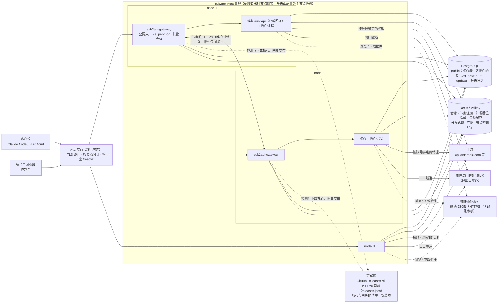

每个节点的公网入口是网关外壳 `sub2api-gateway`（`next/gateway`）：它监听对外端口、启停并监督本机核心进程（核心只监听回环地址）、执行托管升级，本机核心不可用或维护中时把请求转给其他节点（CONTRACTS §33、§34、§39）。外层反向代理只做 TLS 终止和按节点分流，可以没有。部署入口见 [`deploy/gateway`](../deploy/gateway/README.md)；不经网关、只跑核心的单机栈见 [`deploy/single`](../deploy/single/README.md)，e2e 栈（两个节点前面一个 Caddy）见 [`deploy/e2e`](../deploy/e2e/README.md)。

要点：

- **节点对等**：任何节点都能处理网关请求和管理请求；只有升级时由配置的主节点协调（`primary-first-v1`：从节点先转发到主节点并停止，主节点停机、迁移、启动，再逐个恢复从节点；不改库的版本可走 `rolling-v1` 逐个节点滚动，见 GATEWAY-MANAGED-UPDATES.md、CONTRACTS §34、§82）
- **PostgreSQL 是期望状态和账本的唯一依据**
- **Redis 保存实时状态**，数据丢失后几秒内自动恢复；余额缓存丢失时回源 PG。本文的"Redis"指任何 Redis 协议的服务，默认部署用 Valkey（Redis 7.2 的分支，协议、命令、Lua 均兼容），Redis 7+ 同样可用；`SUB2API_REDIS_URL` 接受 `redis://`、`rediss://`、`valkey://`、`valkeys://`、`unix://`
- **插件进程运行在每个节点本地**，通过本机 unix socket 与核心通信，所有对外连接经核心的出口隧道
- **版本检测与一键更新**：核心与网关两条版本线由 GitHub Actions 打包发布（tag `core-v*`、`gateway-v*`）；清单不签名，网关信任配置的更新源，只校验摘要（发布摘要是清单原文的 sha256）。升级主节点每 6 小时从集群配置的更新源（GitHub 仓库，或带 `releases.json` 的 HTTPS 目录）检测两条线的新稳定版，结果存 PG `updater.update_checks`；管理员在控制台点“一键更新”，网关导入并校验发布、建升级计划。核心走上面两种策略；网关走 `gateway-rolling-v1`：各节点先下载新二进制到 `<root>/gateway/<版本>/`，再逐个节点让出流量、停核心、改 `<root>/gateway/current` 并 exec 新网关、拉起原核心。从不自动升级（CONTRACTS §102）

### 2.2 节点内部架构

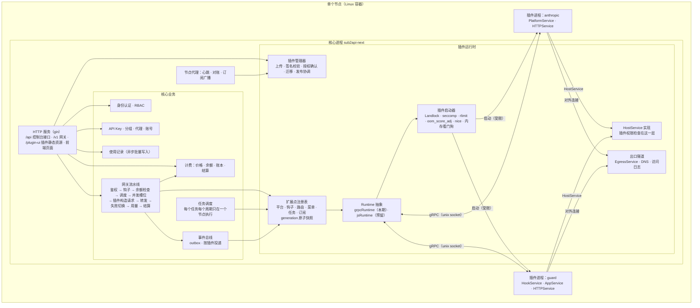

**分层规则**：

- 核心业务只依赖 `Runtime` / `Instance` 接口；**除 `grpcruntime` 包以外，任何地方都不直接使用 go-plugin 或 gRPC 客户端**
- 网关热路径上，每个请求最多调用：每个匹配的请求钩子一次 + 平台插件一次；流式响应的逐块处理由核心按插件声明的规则执行
- 上游请求由**核心**发出；插件自己的对外连接也由核心的出口隧道转发

### 2.3 多节点协作

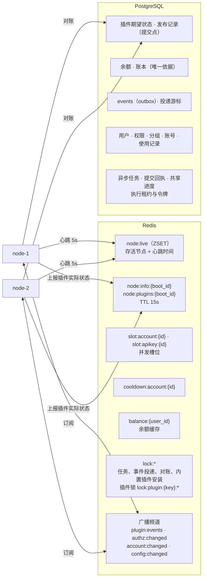

| 机制 | 说明 |
|---|---|
| 节点身份 | `node_id`（环境变量 `NODE_ID`，其次主机名）+ `boot_id`（每次启动生成） |
| 存活判断 | 每 5 秒心跳，15 秒没有心跳视为下线；共享存活分数及筛选统一使用 Redis 时间，避免节点钟差误删活跃节点 |
| 状态同步 | 状态变更通过 Redis 广播，节点收到后立即对账；另有每 5 秒一次对账兜底 |
| 自我隔离 | 连续 15 秒无法和 Redis/PG 通信的节点，停止接收依赖插件的请求（返回 503） |
| 并发槽位 | 成员为 `boot_id:request_id:lease_id`；共享到期判断使用 Redis 时间，只续期现存未过期成员。续期出错或成员丢失都不影响在跑的请求，丢失时重新写入（CONTRACTS §78.5）；持有表按完整槽键和成员区分 API Key 槽、账号槽和重试 |
| 异步任务 | 核心登记用户归属、原账号和初始快照，按 PG 执行令牌与租约领取轮询；快照和财务结果同事务提交。客户端查询任一节点均读取共享快照，详见 CONTRACTS §28 |
| 单节点执行 | 插件任务、事件投递、对账、保留清理、内置插件安装用 Redis 锁（redsync，`core.Locker`）保证同一时刻只在一个节点执行；**没有 PG 兜底**，连不上 Redis 的节点不拿锁。锁不带 fencing token，不可幂等的工作另有数据库层保护（CONTRACTS §27）。插件自己需要按需互斥时，凭宿主权限 `lock` 经 `HostService.LockAcquire/LockRenew/LockRelease` 使用同一套锁，key 由宿主强制加上 `plugin:{plugin_key}:` 前缀，owner token 由插件生成（CONTRACTS §27.3）。核心迁移、插件 schema 迁移、IAM 引导用的是各自独立的 PG advisory lock，与 Redis 锁无关 |

---

## 3. 核心与插件的划分

| 模块 | 职责 | 属于 |
|---|---|---|
| `iam` / `authz` | 用户、登录会话；权限目录、角色、鉴权、缓存与失效 | 核心 |
| `apikey` / `group` | API Key；分组、账号归属、倍率、模型白名单、可用用户 | 核心 |
| `proxy` / `account` | 代理；通用账号表、凭证加密、状态与冷却 | 核心 |
| `billing` | 模型价格、余额、账本、余额检查、结算 | 核心 |
| `usage` | 使用记录、幂等结算、核心托管异步任务的身份/轮询/共享快照（CONTRACTS §28） | 核心 |
| `gateway` | 网关流水线（协议无关）、动态端点路由、调度、粘性会话、并发、协议转换、发送与中继（插件构造的请求经核心的 HTTP 客户端发出）、失败切换、钩子执行、用量提取 | 核心 |
| `event` / `job` | 事件 outbox 与投递、任务调度 | 核心 |
| `cluster` | 节点注册、心跳、广播、分布式锁 | 核心 |
| `plugin` | 插件包、签名与信任、manifest、授权确认、迁移、注册表、发布、Runtime 抽象、市场索引 | 核心 |
| `plugin/grpcruntime` | go-plugin 进程管理、HostService、EgressService | 核心 |
| `plugin/sandbox` | 启动器：Landlock、seccomp、rlimit、oom_score_adj、nice；内存看门狗 | 核心 |
| anthropic 插件 | `apikey` 账号类型（支持内置平台 anthropic）：`Execute` 构造上游请求（`sdk/pluginsdk/standard`）、错误分类；默认价格 | **插件** |
| guard 插件 | 请求钩子（关键词拦截）、事件订阅（统计）、后台任务（汇总与清理）、对外告警、原生界面 | **插件** |

**划分原则**：核心负责"数据、钱、安全、调度"，以及内置平台（anthropic、openai、gemini）的端点定义——它们是数据文件（`sdk/platforms/*.json`），流水线代码本身不针对任何平台写死逻辑；插件负责"某种账号怎么对接上游"以及"额外的业务逻辑"。平台插件拿到完整请求体，构造最终的上游请求，交给核心的 HTTP 客户端发出（账号代理、SSRF、超时、运营方的请求头设置由核心强制）；用量与任务事实只在插件调用的返回值里（CONTRACTS §112）。插件**永远不能直接改余额**，只能调用受限的账本接口。

---

## 4. 数据模型

### 4.1 ER 图

```mermaid
erDiagram
  users ||--o{ casbin_rule : "g u:id"
  roles ||--o{ casbin_rule : "p and g r:key"
  permissions ||--o{ casbin_rule : "p action"
  plugins ||--o{ permissions : registers
  users ||--|| user_balances : owns
  users ||--o{ balance_ledger : entries
  users ||--o{ api_keys : owns
  groups ||--o{ api_keys : binds
  groups ||--o{ account_groups : contains
  accounts ||--o{ account_groups : member
  segments ||--o{ users : has_members
  segments ||--o{ segment_groups : granted_and_rated
  groups ||--o{ segment_groups : open_to
  groups ||--o{ price_rules : prices
  groups ||--o{ group_model_rates : model_rates
  segments ||--o{ segment_model_rates : model_rates
  groups ||--o{ segment_model_rates : rated_in
  proxies ||--o{ accounts : used_by
  plugins ||--o{ accounts : defines_type
  plugins ||--o{ model_prices : default_price
  users ||--o{ usage_logs : makes
  accounts ||--o{ usage_logs : served_by
  publishers ||--o{ publisher_keys : has
  publishers ||--o{ plugin_versions : signs
  plugins ||--o{ plugin_versions : has
  plugins ||--o{ plugin_permission_grants : approved
  plugins ||--o{ plugin_migrations : applied
  plugins ||--o{ plugin_rollouts : rollout
  plugins ||--o{ plugin_event_cursors : consumes
  plugins ||--o{ plugin_job_runs : runs
  plugins ||--o{ plugin_egress_logs : connects

  users {
    bigint id PK
    string email
    string password_hash
    string status
    bigint segment_id FK
  }
  segments {
    bigint id PK
    string kind
    string name
    boolean is_default
    bigint user_id FK
    bigint origin_id FK
  }
  segment_groups {
    bigint segment_id FK
    bigint group_id FK
    boolean granted
    numeric rate_override
  }
  segment_model_rates {
    bigint segment_id FK
    bigint group_id FK
    string model
    numeric rate
  }
  group_model_rates {
    bigint group_id FK
    string model
    numeric rate
  }
  price_rules {
    bigint id PK
    bigint group_id FK
    string model
    string mode
    jsonb config
    string expression
    string expr_hash
  }
  user_balances {
    bigint user_id PK
    numeric balance
  }
  balance_ledger {
    bigint id PK
    bigint user_id FK
    numeric delta
    numeric balance_after
    string kind
    string idempotency_key
    string plugin_key
  }
  groups {
    bigint id PK
    string name
    numeric rate_multiplier
    string visibility
    jsonb model_allowlist
  }
  api_keys {
    bigint id PK
    bigint user_id FK
    bigint group_id FK
    string key_hash
    string status
  }
  accounts {
    bigint id PK
    string plugin_key FK
    string platform
    string type
    bytea credentials_enc
    jsonb settings
    bigint proxy_id FK
    string status
    int priority
    int max_concurrency
  }
  model_prices {
    bigint id PK
    string model
    string mode
    jsonb config
    string expression
    string expr_hash
    string source
  }
  usage_logs {
    bigint id PK
    string request_id
    bigint user_id FK
    bigint group_id FK
    bigint account_id FK
    string model
    int input_tokens
    int output_tokens
    numeric total_cost
    string billing_mode
    string matched_tier
    string expr_hash
    string billing_status
  }
  permissions {
    bigint id PK
    string key
    string source
    string plugin_key FK
    string status
  }
  plugins {
    string key PK
    string status
    string active_version
    jsonb resource_limits
    string egress_policy
  }
  plugin_versions {
    string plugin_key PK
    string version PK
    jsonb manifest
    bigint publisher_id FK
    string signature_status
    string trust_level
  }
  publishers {
    bigint id PK
    string name
    string trust_level
    string status
  }
  publisher_keys {
    string key_id PK
    bigint publisher_id FK
    string public_key
    string status
  }
```

`roles`、`casbin_rule`、`proxies`、`account_groups`、`segments`、`segment_groups`、`segment_model_rates`、`group_model_rates`、`price_rules`、`plugin_permission_grants`、`plugin_migrations`、`plugin_rollouts`、`events`、`plugin_event_cursors`、`plugin_event_deadletters`、`plugin_job_runs`、`plugin_egress_logs` 的字段见各章节。

授予与角色指派只存在 `casbin_rule`（0.1.290 起，迁移 0100，CONTRACTS §99.1）：p 行是角色的授予，g 行是用户的角色；它没有外键，按角色 key、权限 key、用户 id 引用，上图的连线是这些引用而不是外键。原来的 `user_roles`、`role_permissions`、`role_permission_scopes` 已由 0100 转换后删除。

用户分组（代码里叫 segment）的表 `segments`、`segment_groups` 和 `users.segment_id`、账号分组的模型价格 `price_rules` 是 2026-11-12 加的（迁移 0095），两张模型倍率表 `group_model_rates`、`segment_model_rates` 是 2026-11-23 加的（迁移 0124）（7.1、7.3，CONTRACTS §97）：每个用户属于一个用户分组，私有账号分组授权给用户分组，用户分组在账号分组里可以有自己的倍率和模型倍率；模型价格只属于账号分组。原来的“用户 ↔ 分组”授权表 `user_groups` 由它们取代，表还在，但不再读写。

### 4.2 PostgreSQL schema 划分

| schema | 内容 | 谁来迁移 |
|---|---|---|
| `public` | 所有核心表 | 核心启动时执行（advisory lock 保证只执行一次） |
| `public`，表名带前缀 `plg_<插件key>__` | 插件自己的表，归插件的数据库身份所有 | 核心在发布插件时以插件的身份执行插件包里的迁移脚本（CONTRACTS §130） |

### 4.3 accounts（通用账号表）

| 字段 | 说明 |
|---|---|
| `plugin_key` / `type` | 账号类型（`(plugin_key, type)` 唯一标识），合法取值来自插件注册表，**不在 SQL 里写死**；账号能服务哪些端点由账号类型声明的协议决定（6.6） |
| `credentials_enc` | 凭证整体 AES-256-GCM 加密（主密钥 `MASTER_KEY`）；插件声明的敏感字段接口中永远脱敏 |
| `settings` | 非敏感配置（base_url 等，由账号类型的 `settingsFields` 决定），明文 JSONB |
| `proxy_id` / `status` / `schedulable` / `priority` / `weight` / `max_concurrency` | 代理、状态、是否参与调度、优先级（越大越优先，2026-11-09 起）、权重（同优先级内加权随机）、最大并发 |
| `models` / `model_mapping` | 账号可服务的模型列表（完整模型 ID，空 = 全部）与"客户端模型 → 上游模型"映射；都是核心属性，与插件无关（CONTRACTS §18）。核心在调插件 `Execute` 前改写模型。模型列表可从上游拉取：插件 `BuildModelsRequest` 构造请求，核心发出并提取 ID（CONTRACTS §19） |
| `rpm_limit` / `tpm_limit` | 每分钟请求数和 token 数上限，0 = 不限；计数在 Redis `rl:account:{id}:*` |
| 冷却 | Redis `cooldown:account:{id}`，不写 PG |

插件被**禁用**时账号保留、不参与调度；被**卸载**时账号默认保留（标记"所属插件已卸载"），勾选"清除数据"才删除。

---

## 5. 插件系统

### 5.1 插件包结构（`.s2plugin`，zip 格式）

```
guard-0.1.0.s2plugin
├── manifest.json               # 插件元数据
├── signature.json              # 发布者签名（见第 11 章）
├── runtimes/
│   ├── linux-amd64/plugin      # 生产环境只需要 Linux 版本
│   └── linux-arm64/plugin
├── ui/
│   ├── iframe/                 # 沙箱 iframe 页面（可选）
│   └── native/                 # 原生微前端：entry.js + chunks + css（可选，需要受信）
├── migrations/                 # 插件 schema 的迁移脚本
└── i18n/{zh,en}.json
```

### 5.2 manifest.json（完整字段）

```jsonc
{
  "apiVersion": 1,
  "key": "guard",                               // 发布者内唯一：小写字母、数字、下划线；插件 id = 发布者 + key（CONTRACTS §137）
  "name": { "zh": "请求守卫", "en": "Guard" },
  "version": "0.1.0",                           // semver
  "publisher": "sub2api",                       // 发布者 id，与 signature.json 中的发布者一致；sub2api 只给官方级别的包
  "runtime": "grpc",                            // 预留 "js"
  "entry": { "grpc": { "binaries": "runtimes/{os}-{arch}/plugin" } },
  "hostCompat": ">=0.1.0 <0.2.0",
  "hostUICompat": "^1.0",                       // 使用原生微前端时必填

  "capabilities": [                             // 插件实现了哪些能力
    { "id": "gateway.hook.v1" }, { "id": "app.events.v1" }, { "id": "app.jobs.v1" },
    { "id": "http.routes.v1" }
  ],

  "platform": { /* 平台插件才有，见 15.1 */ },

  "hooks": [ {
    "point": "gateway.request",
    "order": 100,                               // 越小越先执行
    "match": { "protocols": ["anthropic.messages"], "models": ["*"], "groups": ["*"] },
    "needs": ["model", "prompt_text"],          // 需要的请求字段；prompt_text 由核心从请求体中提取纯文本
    "maxPromptBytes": 32768,
    "timeoutMs": 300,
    "failure": "open"                           // 超时或出错时：open 放行 / closed 拒绝
  } ],

  "scheduler": {                                // 可选：参与调度，见 6.2 与 CONTRACTS §24
    "rank": {                                   // 改写候选账号的 priority / weight
      "order": 100,                             // 多个插件按 order 串行，后者看到前者的结果
      "match": { "protocols": ["anthropic.messages"], "models": ["claude-*"], "groups": [] },
      "timeoutMs": 200                          // 0 = 宿主默认；固定 fail open，没有 failure 字段
    }
  },

  "events": { "subscribe": ["usage.recorded"], "batchSize": 100 },
  "jobs": [ { "id": "rollup", "schedule": "@every 5m", "timeoutSec": 60 },
            { "id": "cleanup", "schedule": "0 3 * * *", "timeoutSec": 300 } ],

  "database": { "migrations": "migrations/" },  // 表名带前缀 plg_guard__；插件以外的表在 "access" 里申请，要 db.core_read（CONTRACTS §130）

  "userPermissions": [                          // 登记为 plugin.guard:<key>；risk/defaults 等需核心 >=0.1.290（CONTRACTS §4）
    { "key": "rules:read",   "label": { "zh": "查看拦截规则" }, "defaults": { "admin": true, "operator": true } },
    { "key": "rules:manage", "label": { "zh": "管理拦截规则" }, "risk": "sensitive",  // low（默认）/ sensitive / critical
      "requires": ["rules:read"], "defaults": { "admin": true } },              // defaults：首次登记时建议授予的内置角色
    { "key": "stats:read",   "label": { "zh": "查看拦截统计" } }                     // 不写 defaults 不授予任何角色
  ],

  "routes": [                                   // 挂在 /api/plugins/guard/ 下，核心先鉴权再转发
    { "method": "GET",  "path": "/rules", "scope": "admin", "permission": "rules:read" },
    { "method": "PUT",  "path": "/rules", "scope": "admin", "permission": "rules:manage" },
    { "method": "GET",  "path": "/stats", "scope": "admin", "permission": "stats:read" }
  ],

  "ui": {
    "menus": [ { "id": "guard", "section": "plugins", "label": { "zh": "请求守卫" },
                 "page": "dashboard", "permission": "stats:read" } ],
    "pages": { "dashboard": { "type": "native", "component": "GuardDashboard" } },
    "slots": [ { "slot": "dashboard.widgets", "component": "BlockedTodayCard",
                 "permission": "stats:read" } ],
    "native": { "entry": "ui/native/entry.js" },
    "settings": { "mode": "native", "component": "GuardSettings", "secrets": [] }
  },

  "resources": { "memoryMB": 128, "cpu": 0.25, "maxProcs": 64, "maxOpenFiles": 256 },

  "hostPermissions": [
    { "id": "kv" },
    { "id": "db.schema", "reason": { "zh": "保存拦截规则和统计" } },
    { "id": "gateway.hook", "scope": { "points": ["gateway.request"], "fields": ["model", "prompt_text"] },
      "reason": { "zh": "检查请求内容" } },
    { "id": "events", "scope": { "subscribe": ["usage.recorded"] } },
    { "id": "jobs" },
    { "id": "routes.admin" },
    { "id": "ui.native", "reason": { "zh": "提供统计大盘" } },
    { "id": "net", "scope": { "domains": ["hooks.example.com"] }, "optional": true,
      "reason": { "zh": "命中规则时发送告警（出口策略为白名单时生效）" } }
  ],

  "externalServices": ["hooks.example.com"]
}
```

安装时核心做一致性检查：manifest 里用到的每一种能力都必须申请对应的 `hostPermissions`（比如声明了 `hooks` 就必须申请 `gateway.hook`，且 `needs` 不能超出批准的 `fields`）；`capabilities` 必须是 `runtime` 支持的；`userPermissions` 的 key 不能冲突；`ui.native` 要求发布者信任级别为 official 或 verified。

### 5.3 gRPC 契约

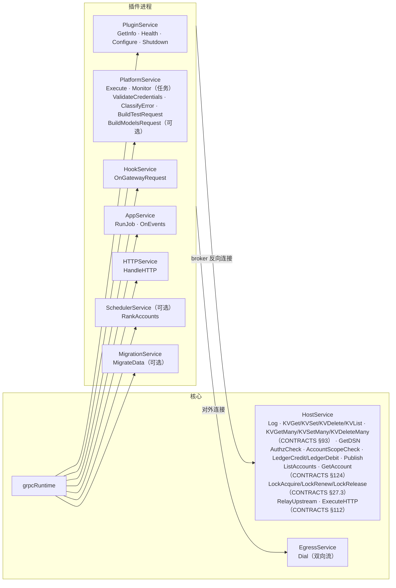

proto 设计规则（为以后的 JS 运行方式预留）：

- 除 `EgressService.Dial` 外，所有方法都是"一次请求、一次响应"
- 不使用 `google.protobuf.Any`；字段按 protojson 规则可以直接映射成 JS 对象
- 平台插件在 `Execute` 里拿到完整请求体，交回最终字节；网关钩子仍只拿声明的字段，返回"设置/删除"指令（`BodyPatch`），由核心执行

关键消息（示意）：

```proto
// 平台插件：一次尝试（CONTRACTS §112）
message ExecuteRequest {
  RequestMeta meta = 3;                      // protocol "anthropic.messages"、model（映射后）……
  Account account = 4;                       // 含解密后的凭证和 settings
  bytes body = 5;                            // 完整请求体，核心的改写已做完
  map<string, string> inbound_headers = 6;   // 清单 passHeaders 内的客户端请求头（写成 [] 时一个都不给）
  bool extract_usage = 8; bool task_submission = 9;
}
// 插件在 Execute 里调 HostService.RelayUpstream 交出最终请求
message UpstreamRequest {
  string method = 1; string url = 2;         // 核心校验：http(s)，主机须在清单 externalServices 或账号的上游地址里（§112.17），SSRF
  map<string, string> headers = 3;           // 权威头（鉴权、签名）
  map<string, string> default_headers = 4;  // 默认头（运营方设置可改）
  bytes body = 5;                            // 最终字节
}
message ExecuteResponse {
  ClassifyErrorResponse classification = 1;
  oneof report { UsageReport usage = 2; HostUsage host_usage = 3; TaskSubmission task = 4; }
}

// 平台插件：错误分类
message ClassifyErrorResponse {
  Action action = 1;                         // RETURN_TO_CLIENT / FAILOVER
  AccountEffect account_effect = 2;          // NONE / COOLDOWN(until) / DISABLE(reason)
  int32 client_status = 3;
}

// 钩子插件：请求检查
message GatewayRequestHookRequest {
  RequestMeta meta = 1;                      // request_id、protocol、model、stream、user_id、api_key_id、group_id、client_ip
  map<string, string> fields = 2;            // 按 needs 提供，prompt_text 为提取出的纯文本
}
message GatewayRequestHookResponse {
  Decision decision = 1;                     // ALLOW / DENY
  int32 deny_status = 2;                     // 默认 403
  string deny_code = 3;
  string deny_message = 4;
  repeated BodyPatch patches = 5;            // 只能改 needs 里声明过的字段
}

// 应用插件：任务与事件
message RunJobRequest   { string job_id = 1; int64 scheduled_at = 2; }
message OnEventsRequest { repeated Event events = 1; }   // Event{id, type, occurred_at, payload_json}
message OnEventsResponse { int64 acked_through_id = 1; } // 已处理到的事件 ID

// 出口隧道
service EgressService { rpc Dial(stream EgressFrame) returns (stream EgressFrame); }
message EgressFrame {
  oneof kind { DialOpen open = 1; DialResult result = 2; bytes data = 3; DialClose close = 4; }
}
```

### 5.4 插件生命周期

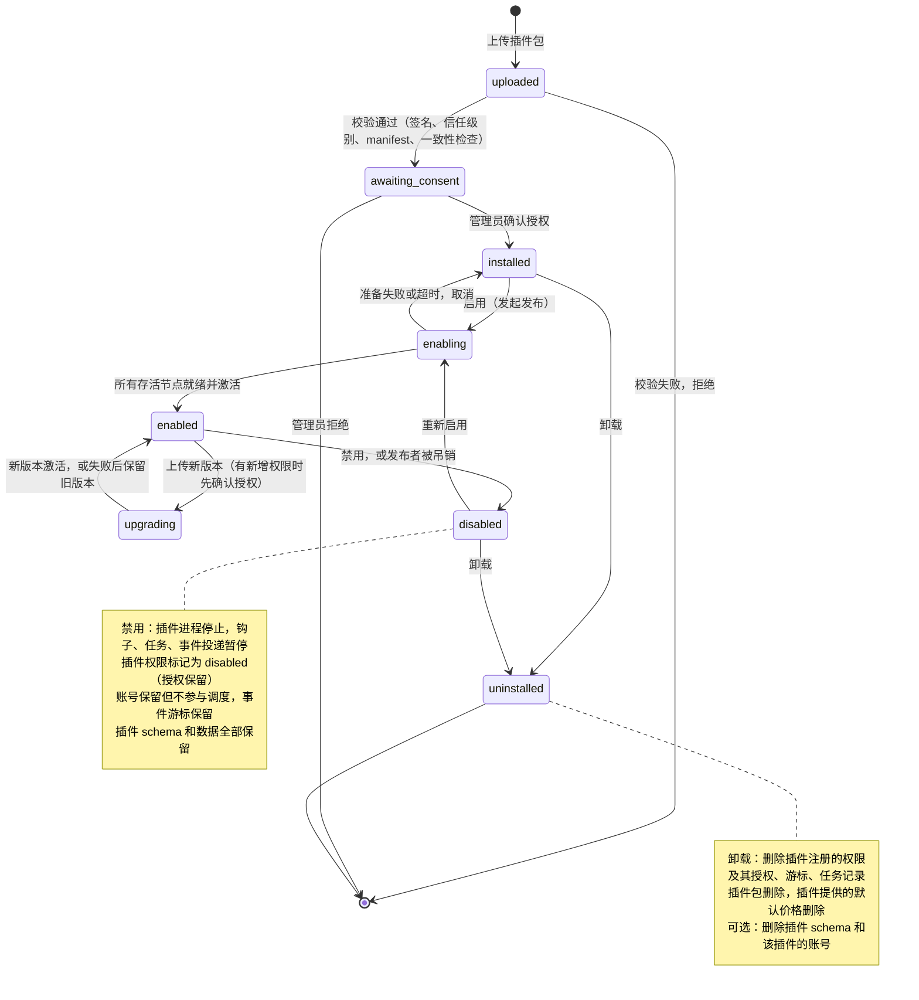

### 5.5 授权确认

- `hostPermissions` 按风险分级（以 `sdk/manifest/manifest.go` 的 `HostPermissionRisk` 为准；低风险在确认授权时自动授予，见 `plugin/install/consent.go`；管理员撤销过的不再自动授予，只有同意里显式授予才恢复，CONTRACTS §5.7）：

| 等级 | 权限 |
|---|---|
| 🟢 低 | `kv`、`config`、`log`、`broadcast`、`secrets`（§72.2）、`prices`（只读按模型价格试算费用，§72.13.1） |
| 🟡 中 | `routes.admin`、`routes.user`、`events`、`jobs`、`ui.menu`、`ui.iframe`、`authz.read`（`AuthzCheck` 查询非本插件的权限 key）、`lock`（CONTRACTS §27.3）、`fs.data`（读写本插件的数据目录，不授予时插件不能读写任何文件，CONTRACTS §43.8） |
| 🟠 高 | `accounts.auto_state`、`db.schema`、`net`（白名单模式下）、`routes.public`、`routes.webhook`、`gateway.hook`、`gateway.endpoint`、`gateway.observe`、`platform.register`、`scheduler.rank`、`sticky.clear`（§74.2）、`payment.gateway`（验签通过的通知可把本网关的订单标为已支付，金额以订单为准，§140）、`users.read`、`notify.send`（经其他插件的渠道向任意外部地址发通知，核心限速，§74.4） |
| 🔴 极高 | `ledger.credit`、`ledger.debit`、`ui.native`、`users.write`、`db.core_read`（清单 `database.access` 申请的插件以外的表，CONTRACTS §130.4） |

- 高和极高风险需要逐项勾选；极高风险只能由拥有 `plugin:grant:critical` 的用户批准（2026-10-05 起不再要求再次输入密码，CONTRACTS §3.3）
- 批准结果写入 `plugin_permission_grants(plugin_key, permission, scope, status, plugin_version, manifest_hash, granted_by, granted_at)`；管理员可以把范围改得比申请的更小（比如入账上限）
- 运行时插件每次调用 HostService，核心都在服务端检查授权
- 升级时新增权限或扩大范围，新版本进入 `awaiting_consent`，旧版本继续运行；有版本在运行时，对新版本的同意先记为待生效授予（`plugin_staged_grants`），只作用于新版本的实例，发布提交时才成为插件的授予，升级失败或取消时撤回（CONTRACTS §5.7）

### 5.6 插件数据库：表、身份与迁移（CONTRACTS §130）

| 项目 | 做法 |
|---|---|
| 表 | 在核心的模式里（核心连接的 `current_schema()`，线上 `public`），表、索引、序列、视图一律以 `plg_<插件 id>__` 开头（`manifest.TablePrefix`；第一方插件的 id 就是 key，其他发布者的是 `_<发布者>__<key>`，CONTRACTS §137） |
| 数据库身份 | 每个插件一个登录角色 `plg<库OID>_<插件 id>`，密码由主密钥派生、不落库（设密码只发 SCRAM 校验值）；插件的表归它所有，核心的表和别的插件的表它没有权限。核心的用户要有 `CREATEROLE`，否则 `plugin_db_isolation_unavailable`，插件不启动 |
| 连接 | `HostService.GetDSN` 一律给不带凭据的虚拟地址 `db.sub2api:5432`，连接经出口隧道到核心的 pgproxy，核心以插件的身份登录（`search_path` 为核心的模式）后原样转发协议；插件进程里没有数据库密码，核心的真实数据库地址任何插件都连不上 |
| 插件以外的表 | 清单 `database.access` 逐表申请列和权限（select/insert/update/delete/references），要 `db.core_read`（极高风险）；授予记在该授予的范围里，升级多要任何东西都要重新同意；身份的 GRANT 照授予执行 |
| 迁移脚本 | 核心临时给身份模式的 CREATE，以身份另开连接执行 `migrations/*.sql`，按文件名排序，每个文件一个事务；身份建了不带前缀的对象就回滚该文件；结束或失败都收回 CREATE |
| 迁移记录 | 插件自己的表 `plg_<key>__schema_migrations(migration_id, checksum, applied_at)`，与脚本同一事务写入；已执行文件被修改时重新执行并更新校验和（脚本必须幂等，CONTRACTS §36）。核心的 `plugin_migrations` 只记数据迁移 |
| 执行时机 | 发布的"准备"阶段、任何节点激活新版本之前；插件迁移锁（advisory lock） |
| 数据迁移 | 简单转换写在 SQL 里；复杂转换实现 `MigrationService.MigrateData(from, to)`，在 SQL 之后调用 |
| 兼容要求 | 升级期间新旧版本同时运行，迁移必须"先扩展、后收缩" |
| 卸载 | 清除数据：删前缀下的全部关系、`DROP OWNED`、`DROP ROLE`；保留数据：`REASSIGN OWNED` 给核心、`DROP OWNED`、`DROP ROLE`，重装时交还新身份 |
| 旧布局 | 0.1.303 及更早的 `plg_<key>` 角色和 schema 在启动时与 Ensure 时搬迁：表改名加前缀、移进核心的模式，迁移记录搬进插件的记录表（过渡代码，CONTRACTS §130.8） |

### 5.7 多节点发布（先准备、再激活）

由**发起操作的节点**负责协调；它宕机后，其他节点在租约过期后接管。

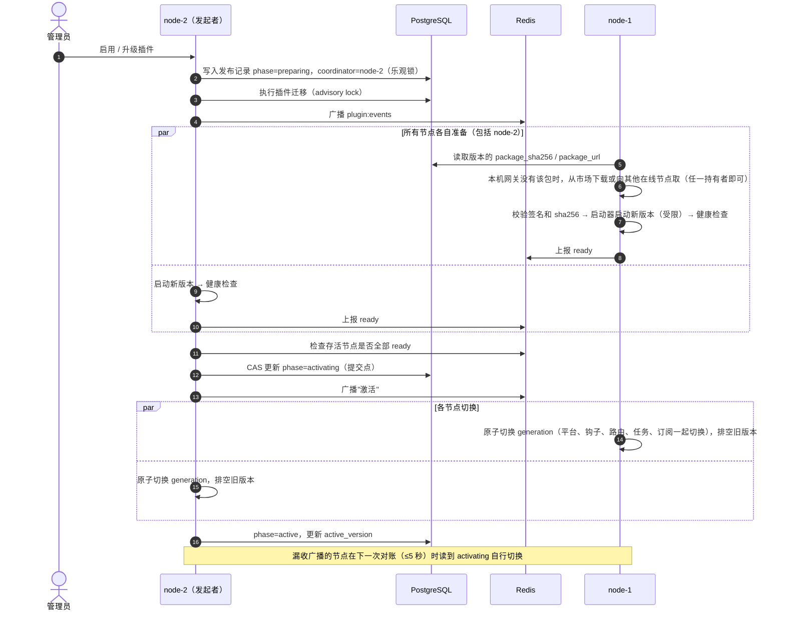

| 异常 | 处理 |
|---|---|
| 某节点准备失败或超时 | 不阻塞其他节点（2026-10-02，CONTRACTS §36）：至少一个节点就绪后，其余节点都已就绪或失败、或准备期满即提交；没有任何节点能就绪才取消发布 |
| 发起者在提交点之前宕机 | 租约过期后其他节点接管，继续等待或判定超时 |
| 发起者在提交点之后宕机 | 所有节点读到 `activating` 就必须切换，接管者只负责收尾 |
| 发布期间有节点加入 | 读到 `preparing` 就启动旧版本接流量、新版本待命；读到 `activating`/`active` 直接启动新版本 |
| 激活时某节点新版本进程已崩溃 | 该节点继续用仍在运行的旧版本服务并重试新版本，就绪后自行切换（CONTRACTS §36）；本节点没有旧版本时插件在该节点不可用 |

---

## 6. 网关

### 6.1 请求流水线（`POST /v1/messages`）

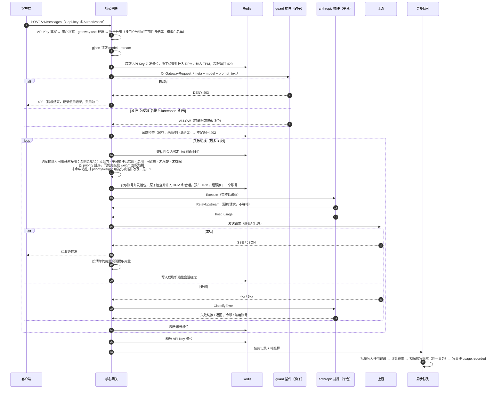

说明：

- 流式响应一旦开始输出，就不再失败切换
- 插件在构造请求时出错或不可用时，请求没有发出，换下一个账号、不惩罚账号（发布了故障策略时同样，不执行账号规则，CONTRACTS §58）；所有账号不可用返回 503。`Execute` 不计时（CONTRACTS §112.16）：插件挂住时这次尝试一直等，直到客户端离开或插件进程结束
- 插件自己解析用量的端点和任务提交用等待形式：插件在 `RelayAndWait` 里等交换结束、读观察，在返回值里给 `usage` 或 `task`（CONTRACTS §112.7）。执行行由网关每 15 秒续期，节点崩溃时恢复扫描在 2 分钟没有续期后把它关成“未上报”、释放预扣
- 一次请求上的超时和大小上限只有管理员配置的（请求体上限、上游的响应头 / 整体 / 流式空闲超时、钩子和热路径超时），加上安全与防崩溃的检查；完整列表见 CONTRACTS §112.16
- 客户端断开时取消上游请求、释放槽位；已产生的用量照常结算

### 6.2 调度

- 候选账号 = API Key 所属分组的账号 ∩ 账号类型能服务该端点（原生或经转换）的账号 ∩ 账号在该入站协议下提供请求的模型（账号的协议绑定，CONTRACTS §110：跨平台转换默认关闭，按模型开启） ∩ 状态正常 ∩ 参与调度 ∩ `models` 为空或含请求模型 ∩ 未冷却 ∩ 未达 rpm/tpm/spm 上限
- 顺序：粘性绑定的账号优先；其余按 `priority` 升序，同优先级按 `weight` 加权随机（不放回抽样）；逐个获取并发槽位，失败切换时跳过已试过的账号（CONTRACTS §18）。排序用的 `priority` / `weight` 可能已被插件为本次请求改写（见下）
- **插件改写调度参数（可选扩展点，CONTRACTS §24）**：声明了 `scheduler.rank` 的插件可以为**一次请求**改写候选账号的 `priority` 和 `weight`，核心拿改写后的值跑上面这套算法。只对**未命中粘性绑定**的请求调用，每个请求一次（失败切换复用结果），多个插件按 `order` 串行、后者看到前者的结果；超时、出错或结果非法一律 fail open，退回账号自身的值。候选集的筛选、并发槽位、限流、冷却、端点与模型支持性仍全部由核心把关 —— **核心保留最终调度权**，插件只是临时改写账号本来就有的两个参数，不能凭空加账号，也不写库。本次实际发生的改写记入 `usage_logs.sched_decisions`（jsonb，迁移 0011，接口暂不暴露，CONTRACTS §24.5）
- 限流：rpm/tpm 逐条记录，判断和展示都是精确的近 60 秒（CONTRACTS §68.3），tpm 设了上限时准入即预占（§78.3）；tpd 已移除；spm 是 60 秒滚动窗口内去重的会话数（会话 = 粘性会话键，无粘性规则时每请求一会话；窗口内已有的会话总是放行）。达到上限的账号在本窗口内不参与调度；全部不可用时返回 429 `rate_limited`
- 模型映射：选定账号后，核心把请求里的模型（body `modelPath` / 路径参数 / `RequestMeta.model`）换成映射后的模型再交给插件，`usage_logs.upstream_model` 记录映射后的模型；计费、白名单、粘性、钩子都看客户端模型
- 每个节点缓存分组内的账号快照，`account:changed` 广播时失效
- 并发：账号槽位按 `accounts.max_concurrency`，API Key 槽位按 `api_keys.max_concurrency`（§60），都在 Redis 用 Lua 原子获取；不按用户限制并发（`users.max_concurrency` 列已废弃，保留只为滚动升级时旧核心可读）

### 6.3 网关钩子

| 项目 | 设计 |
|---|---|
| 钩子点（本期） | `gateway.request`：鉴权和分组解析之后、余额检查和调度之前，同步执行，可以放行、拒绝或修改请求 |
| 请求完成后 | 不做同步钩子，改由事件 `usage.recorded` 异步通知（见第 8 章） |
| 匹配 | 按协议、模型（通配符）、分组过滤，只调用匹配的插件 |
| 顺序 | 按 `order` 依次执行；任一插件拒绝即停止；修改指令按顺序叠加 |
| 数据 | 只传 `needs` 声明且已获批准的字段；`needs` 可以是 gjson 路径或查询（如 `messages\|@reverse\|#(role=="user")` 取最后一条用户消息），核心原样用 gjson 取值、传原始 JSON，查询字段只读、不能用于修改指令；`prompt_text` 由核心从 messages 中提取纯文本，最多 `maxPromptBytes` |
| 超时与失败 | 每个钩子单独超时（manifest `timeoutMs`，0–30000；未声明时用设置 `default_hook_timeout_ms`，默认 300ms、最大 2 秒；任何情况下上限 30 秒）；超时或出错按 `failure` 处理：`open` 放行、`closed` 拒绝（返回 503） |
| 熔断 | 同一钩子连续失败 10 次后熔断 30 秒，熔断期间直接按 `failure` 处理，不调用插件 |
| 观测 | 每个钩子的调用次数、拒绝次数、超时次数、耗时，显示在插件详情页 |

### 6.4 网关端点由平台声明

端点属于平台：核心内置 anthropic、openai、gemini 三个平台的端点，插件可以在 manifest 的 `platforms[].endpoints` 里为自己的新平台声明端点（见 6.6），核心流水线按声明执行。端点字段如下（以 anthropic 为例）：

```jsonc
{ "id": "anthropic",                          // 平台（内置平台在 sdk/platforms/*.json）
  "endpoints": [ {
    "id": "messages",
    "method": "POST",
    "path": "/v1/messages",
    "protocol": "anthropic.messages",       // 协议 id："<平台 id>.<名称>"，全局唯一
    "kind": "proxy",                         // 本期只有 proxy：鉴权 → 钩子 → 调度 → 转发 → 计费
    "auth": { "headers": ["x-api-key", "authorization"] },  // 从哪些请求头读 API Key
    "request": {
      "modelPath": "model",                  // gjson 路径
      "streamPath": "stream",
      "promptTextPaths": ["system", "messages.#.content"]   // 供钩子提取 prompt_text
    },
    "response": { "stream": "sse", "nonStream": "json" },
    "errorFormat": "anthropic",              // 核心内置 anthropic / openai / gemini / plain 四种错误格式
    "billing": "usage"                       // usage：按用量计费；free：不计费（如 count_tokens）
  } ]
}
```

| 项目 | 设计 |
|---|---|
| 路由 | 每个 generation 构建一个内层路由表，挂在核心路由之后；插件启用、禁用、升级时随 generation 原子切换（参考 new-api 的 `plugin-router.go`） |
| 冲突检查 | 安装和启用时检查：不能占用核心路由（`/api`、`/plugin-ui`、`/health` 等）；插件平台的 id 不能与内置平台或其他插件的平台重复，端点不能与任何其他平台的端点冲突 |
| 协议归属 | 协议由平台的端点定义；账号类型通过 `accountTypes[].platforms` 声明支持哪些平台，从而为这些平台的端点提供服务（见 6.6） |
| 协议转换 | 核心内置转换器（`gateway/convert`）；端点协议和账号上游协议不同时，核心有对应转换器（或经 `openai.responses` 的两跳组合）就能转换，没有就只调度原生支持该协议的账号（见 6.6、CONTRACTS §88）。同一平台内的转换（chat ↔ Responses）默认生效；转换到账号类型没有声明的平台默认关闭，要在账号上为模型开启（CONTRACTS §110） |
| 以后的扩展 | `kind: "custom"`：由插件的 HTTPService 处理，但复用核心的 API Key 鉴权和计费（用于异步任务类接口） |

### 6.5 粘性会话

同一个会话的连续请求尽量落到同一个账号，以提高上游的缓存命中率。参考 new-api 的 channel affinity 设计，代码自行实现。

**粘性会话只由核心和管理员决定，插件不参与**（2026-10-10；粘性与限流身份、failover 耦合，留在核心）：

| 谁 | 负责什么 |
|---|---|
| 核心 | 规则匹配、会话 key 计算、绑定的存取（Redis，多节点共享）、账号可用性检查、失败策略、命中统计、管理页面；随内置平台（`sdk/platforms/*.json`）带默认规则 |
| 管理员 | 在控制台停用、调整内置规则的优先级，用同名管理员规则覆盖，或新增规则 |

插件 manifest 不能声明粘性规则，也不能计算会话值（原 `SchedulerService.ResolveAffinityKey` / `scheduler.affinity.v1` 已删除）；会话值只从请求取：请求体字段、请求头、API Key、用户。插件仍可通过 `RankAccounts`（`scheduler.rank.v1`，见 6.2 与 CONTRACTS §24）决定**未命中粘性时在候选里怎么排**；命中粘性绑定的请求直接用绑定账号，不会调用 `RankAccounts`。

**规则**：

```jsonc
"stickyRules": [ {
  "name": "claude-code-session",
  "match": { "protocols": ["anthropic.messages"] },  // 内置规则只按协议匹配，不限模型；还可写 models（通配）、userAgentContains
  "keySources": [                               // 按顺序取第一个非空值
    { "type": "body",   "path": "metadata.user_id" },
    { "type": "header", "name": "x-session-id" }
  ],
  "valueRegex": "",                             // 可选：对取到的值做正则截取
  "ttlSeconds": 3600,
  "keyIncludes": ["group", "model", "rule"],    // 会话 key 还包含哪些维度
  "onFailure": "failover"                       // failover：失败时照常切换账号；stick：不切换，直接返回错误（保护缓存）
} ]
```

**调度过程**：

1. 按顺序找第一条命中的规则，计算会话 key：`sticky:{规则名}:{分组}:{模型}:{sha256(取到的值)}`
2. 从 Redis 读取绑定的账号；该账号仍在分组内、可调度、未冷却、未达限流上限、能拿到并发槽位，就直接使用
3. 绑定账号并发满时先排队等它（CONTRACTS §78.5）；仍不可用，或已达限流上限时，`failover` 规则走普通调度，`stick` 规则返回 429
4. 请求成功后写入或刷新绑定（TTL 重新计时）；如果这次用的是新账号，就改绑到新账号（相当于 new-api 的 switch_on_success）
5. 绑定的账号被禁用时，默认删除绑定（可配置为保留）

**其他**：

- 全局开关、默认 TTL、每条规则的命中率统计（Redis 计数），在控制台"粘性会话"页查看和管理，支持按规则清空绑定
- 使用记录中记录本次请求是否命中粘性绑定（`sticky_rule`、`sticky_hit`）
- 规则存在 `sticky_rules` 表：`source=builtin` 由核心启动时同步，`source=admin` 由管理员维护；插件安装、升级、卸载都不改它（约束 `sticky_rules_core_only`，迁移 0048）
- 插件不声明规则，但有 `sticky.clear` 授权的插件可以调用 `HostService.ClearStickyBindings`，按比例删除指向某账号的绑定（例如降权后分流会话，CONTRACTS §74.2）

### 6.6 平台、账号类型、账号、分组与端点

> 2026-09-25 决定（取代 2026-09-24 的"账号类型直接声明协议"版本）。

**关系**

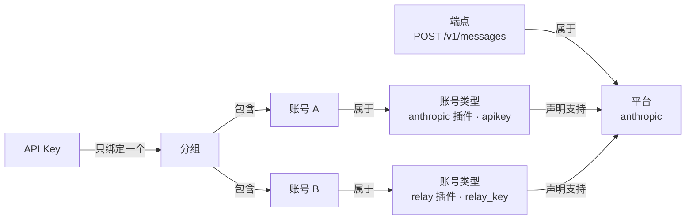

| 概念 | 由谁声明 | 规则 |
|---|---|---|
| 平台 | **核心内置**：`anthropic`、`openai`、`gemini`；插件可以声明新平台 | 平台声明自己的端点（method + path + 协议 + 错误格式 + 用量规则等）。插件不能声明与内置平台或其他插件同 id 的平台；**不同平台的端点不能冲突**（安装时检查，含路径参数的重叠） |
| 端点 | 平台 | 每个端点只属于一个平台；内置平台的端点始终存在，插件平台的端点在插件启用时存在、禁用后 404 |
| 账号类型 | 插件 | 声明支持哪些平台（内置平台或插件平台，可多个）；不同账号类型可以支持同一个平台；声明它的插件负责构造上游请求、分类错误 |
| 账号 | 管理员 | 属于一个账号类型 |
| 分组 | 管理员 | 一组账号（可混放不同类型），一起提供服务 |
| API Key | 用户 | **只绑定一个分组** |

**请求如何调度**

1. 按请求路径匹配端点 → 得到平台 P 和协议
2. API Key → 分组 G
3. 候选账号 = G 中账号类型**支持平台 P** 的账号；此外，账号类型支持的其他平台里若有协议能由核心转换器从本端点协议转换过去，这些账号也是候选：每个类型取转换质量最好（等级、跳数、声明顺序）且流式模式相容的端点；计数端点不转换，没有原生计数端点的类型由核心本地估算（CONTRACTS §88.2）。这些“其他平台”的账号只对在账号上开启了该入站协议的模型参与（`model_protocols`）；支持平台 P 的账号也可以在账号上关闭某个协议，或限定模型只在某些协议下提供（`protocols`、`model_protocols`，CONTRACTS §110）
4. 没有候选账号 → 404/503；候选账号全部被账号的协议绑定过滤（没有账号在这个端点上提供这个模型）→ 404（CONTRACTS §110.5）；有则按粘性会话、优先级（同一优先级内原生 → good → fair → discouraged → local）、并发、失败切换调度
5. 考察到经转换的账号时核心才转换请求（每个类型一次），账号或分组的丢失策略（allow / safe / strict）决定能否接受损失；被拒绝的账号跳过、不计尝试，全部被拒绝时 400 `unsupported_conversion`（CONTRACTS §88.3、§88.4）
6. 选中账号后由其账号类型所属插件构造上游请求；需转换时由核心转换请求和响应，用量按上游协议读取，转换情况记入使用记录 `conversion`

**内置平台**（定义在核心 `sdk/platforms`，不再由插件声明）

| 平台 | 端点 | 协议 | 错误格式 | 用量口径 |
|---|---|---|---|---|
| anthropic | `POST /v1/messages` · `POST /v1/messages/count_tokens`（不计费） | `anthropic.messages` · `anthropic.count_tokens` | anthropic | exclusive |
| openai | `POST /v1/chat/completions` · `POST /v1/responses` · `POST /v1/embeddings` · `POST /v1/images/generations` · `POST /v1/images/edits`（JSON，CONTRACTS §118） | `openai.chat` · `openai.responses` · `openai.embeddings` · `openai.images` · `openai.images_edit` | openai | inclusive |
| gemini | `POST /v1beta/models/{model}:generateContent` · `POST /v1beta/models/{model}:streamGenerateContent` · `POST /v1beta/models/{model}:countTokens`（不计费） | `gemini.generate` · `gemini.stream_generate` · `gemini.count_tokens` | gemini | inclusive |

内置平台同时提供：API Key 读取方式（anthropic：`x-api-key`/`Authorization`；openai：`Authorization: Bearer`；gemini：`x-goog-api-key` 或 `?key=`）、模型与流式标志的位置（gemini 的模型在路径里，流式由端点决定）、转发给插件的请求字段和请求头、用量提取规则、默认粘性规则（`source=builtin`）。

**manifest**

```jsonc
"platforms": [ {                       // 可选：插件自己的新平台（不能与内置或其他插件重名）
  "id": "myvideo", "label": {...},
  "endpoints": [ { "id": "gen", "method": "POST", "path": "/v1/video/generations",
                   "protocol": "myvideo.gen", "auth": {...}, "request": {...}, "response": {...},
                   "errorFormat": "plain", "billing": "usage", "usage": {...} } ],
  "passHeaders": [...], "usage": {...}   // 没有 stickyRules：插件不声明粘性规则，只能经 ClearStickyBindings 清理绑定（6.5）
} ],
"accountTypes": [ {
  "id": "relay_key", "label": {...}, "form": {...}, "sensitiveFields": ["api_key"],
  "platforms": [ { "platform": "anthropic",           // 内置或插件平台
                   "passHeaders": [...],   // 可选覆盖
                   "usage": { "<protocol>": {...} } } ]            // 可选：按协议覆盖用量规则
} ]
```

顶层 `gateway` 与 `platform` 字段删除（端点归属平台）。

**计费**：全局价只按模型设置，不区分平台和账号类型；全局价之上账号分组可以给模型另设价格，倍率按用户分组、账号分组和模型取一层（7.3）。**账号归属**：插件收到它声明的账号类型下账号的全部信息（凭证、代理），不需要宿主授权；账号的请求都由核心发出（CONTRACTS §124，此前要 `accounts.credentials` 授权后账号类型才注册）。**控制台**：账号类型显示支持的平台和可服务的端点；分组可放任意类型账号，并显示分组能服务哪些平台（由其账号类型推出）；API Key 显示所属分组能访问的平台和端点。


---

## 7. 分组、计费与余额

### 7.1 分组

| 字段 | 说明 |
|---|---|
| `name` / `description` / `status` | |
| `rate_multiplier` | 基本倍率，默认 1。某个用户在这个账号分组调某个模型实际按什么倍率付费，还要看模型倍率和他所在的用户分组（7.3） |
| `model_allowlist` | 允许的模型（通配符列表），为空表示不限制 |
| `visibility` | `public`（公开）所有用户可用；`restricted`（界面叫“私有”）只有被授权的用户分组的成员可用 |
| `account_groups(account_id, group_id)` | 分组包含哪些账号，一个账号可以属于多个分组 |

API Key 创建时选择分组（只能选自己可用的分组），网关按 Key 的分组调度。

#### 用户分组与私有账号分组授权（2026-11-12，CONTRACTS §97）

界面上分组叫**账号分组**（代码 group），用户组叫**用户分组**（代码 segment），2026-11-23 改名。私有账号分组原来逐个用户授权（`user_groups`）。现在授权的对象是**用户分组**：

- 每个用户属于且只属于一个用户分组（`users.segment_id`）。代码、表名和接口路径里用户分组叫 segment：`user_groups` 已经是旧授权表的名字，`tier` 在价格里指档位。
- 新用户进内置的“默认”用户分组。管理员可以建命名用户分组，在用户页里把用户移进去。
- 要给单个用户单独授权或设倍率，把他设为**个人专属**（界面称“专享”）：系统为他建一个只有他一个成员的用户分组，可以复制原用户分组的设置，也可以从空白开始；移回命名用户分组时个人专属删除。旧的逐人授权在迁移时就是这样变成个人专属的。
- 账号分组是否对某个用户可用只有一个条件：账号分组是公开的，或他所在的用户分组被授权了它。创建 Key 时的校验、Key 的分组状态、网关鉴权、“我的分组”列表用的是同一段条件。授权每个请求从库里读，改完立即生效。
- 账号分组的模型价格、模型倍率、各用户分组的授权与倍率随账号分组一次提交（POST/PATCH `/groups`），用户分组的倍率随用户分组一次提交（POST/PATCH `/segments`），都在一个事务里（CONTRACTS §97.6）。

| 表 | 说明 |
|---|---|
| `segments` | 用户分组：`kind`（`named` 命名 / `personal` 个人专属）、名称、`is_default`（内置的默认用户分组）。全场折扣 `discount` 已由迁移 0124 换算成用户分组倍率后删除 |
| `segment_groups(segment_id, group_id)` | 用户分组在一个账号分组里的授权（`granted`，只对私有账号分组有意义）和用户分组倍率（`rate_override`，空 = 跟随） |
| `segment_model_rates(segment_id, group_id, model)` | 用户分组在一个账号分组里对一个模型的倍率（0124） |
| `group_model_rates(group_id, model)` | 账号分组对一个模型的倍率（0124） |
| `price_rules` | 账号分组的模型价格（账号分组 × 模型，只有自定义价），见 7.3 |

`user_groups` 表保留，不再读写。

### 7.2 余额与账本

```sql
CREATE TABLE user_balances (
  user_id    bigint PRIMARY KEY REFERENCES users(id),
  balance    numeric(20,8) NOT NULL DEFAULT 0,
  updated_at timestamptz NOT NULL DEFAULT now()
);

CREATE TABLE balance_ledger (
  id              bigserial PRIMARY KEY,
  user_id         bigint NOT NULL REFERENCES users(id),
  delta           numeric(20,8) NOT NULL,      -- 正数入账，负数扣减
  balance_after   numeric(20,8) NOT NULL,
  kind            varchar(30) NOT NULL,        -- usage / admin_adjust / plugin_credit / plugin_debit / refund
  ref_type        varchar(30), ref_id varchar(100),
  idempotency_key varchar(150) NOT NULL UNIQUE, -- usage 结算用 "usage:<request_id>"
  operator_id     bigint,                      -- 管理员操作时记录
  plugin_key      varchar(100),                -- 插件入账时记录
  note            text,
  created_at      timestamptz NOT NULL DEFAULT now()
);
```

- **余额的唯一修改入口是账本**：每次变动在同一个事务里插入账本记录并更新 `user_balances`（`SELECT ... FOR UPDATE`），幂等键保证重复提交不会重复扣款
- 管理员调整余额需要 `balance:adjust`（高危权限，只需权限，无二次验证）
- 插件通过 `HostService.Ledger.Credit/Debit` 变动余额，需要 🔴 权限，受批准的单笔和每日上限约束，并强制幂等键（为以后的支付插件准备）

### 7.3 模型价格（独立页面）

参考 new-api 的计费表达式设计（`pkg/billingexpr`），**代码自行实现，不复制**：new-api 是 AGPL-3.0，sub2api 是 LGPL-3.0，直接复制会带来许可证冲突。表达式引擎使用 MIT 协议的 `expr-lang/expr`。

#### 两种计费方式

| 方式 | 适用 | 配置 | 生成的表达式 |
|---|---|---|---|
| **可视化** | 大多数模型，以及固定价格的调用（图片、搜索等） | 若干档位，每档一个 `when` 条件树（输入长度 `len`、输入 / 输出 token、时段，可“且 / 或 / 非”嵌套），按顺序第一个成立的档位生效，最后一档兜底；每档按 token（输入、输出、缓存读、缓存写 5 分钟 / 1 小时、可选图片输入 / 输出的每百万 token 价格）或按次计价（`unit: request`，按次价就是一个这样的档）；加价规则由请求参数、请求头、用量字段、时段的条件“且”起来 | `tier("base", p*3 + c*15 + cr*0.3 + cc*3.75 + cc1h*6)`；单个按次档是 `tier("base", flat(0.04))`；分档、加价见下方示例 |
| **表达式** | 可视化配不出来的结构（最低消费、多字段组合等） | 只写源码 | 任意合法表达式 |

两种方式最终都保存为一条表达式，**计费只以表达式为准**；可视化是带界面的编辑方式，`config` 只供界面回显，保存时由核心据它生成表达式（2026-11-22 起只留这两种，CONTRACTS §131）。

#### 定价范围（2026-09-24 决定；2026-11-12 加账号分组定价，CONTRACTS §97；2026-11-23 倍率改为四层取一，迁移 0124，§97.10）

一次调用的实付 = 标价 × 倍率。标价和倍率各自解析，都是取先命中的一层，互不影响。

- **全局价只按模型设置**：同一个模型不论由哪个平台的端点、哪种账号类型提供服务，全局价都是同一个；价格表不区分平台
- **全局价之上账号分组可以给模型定自己的价格**（模型价格），存在 `price_rules`（账号分组 × 模型，每个账号分组每个模型至多一条）。标价取先命中的一层：模型价格 → 全局价。模型价格只有独立价格一种（可视化或表达式，与全局价的形状无关，CONTRACTS §131.4）；用户分组不给模型定价。模型价格不要求模型有全局价，任何模型名都能定（没有全局价时只在这个账号分组有标价）；模型价格和全局价都没有时不能计费；账号分组不提供的模型上也可以先定价，提供之后生效。模型倍率、用户分组模型倍率也能设在还没有标价的模型上，有了标价才起作用
- **倍率只取一个**，四层里最具体的那层生效，不相乘：用户分组 × 账号分组 × 模型 → 用户分组 × 账号分组 → 账号分组 × 模型 → 账号分组基本倍率（`core.RateLevels.Rate`）。每层保存时就是最多 4 位小数的数，生效的那个原样存进使用记录的倍率列，首次结算和重试用的是同一个数。网关一次调用 `core.Pricer.Resolve` 从同一份价格快照取标价和模型的两层倍率（账号分组 × 模型、用户分组 × 账号分组 × 模型），鉴权给另外两层；`GET /me/prices?group_id=` 每行给出同样四层取一的倍率，与实际扣费一致。原来的全场折扣和“按倍数”规则由迁移 0124 换算成这些倍率
- 价格表达式算出的仍是**基础价格**：倍率是乘在表达式结果外面的一个数，表达式文本不拼接、不改写（模型价格是另一条完整的表达式）。只有给下游同步的 `GET /key/prices` 把模型倍率与密钥倍率的比值折进它导出的价格（CONTRACTS §97.6）
- 价格按**完整模型 ID** 设置、精确匹配，**不支持通配符**（2026-09-25 决定）：别名和带日期的 ID 是不同的模型，需要分别定价。**价格归核心所有，只能由管理员配置**，插件不提供价格；管理员可以手动录入，也可以从价格同步源（LiteLLM、models.dev 等公开价格库，或上游 sup2api）预览后选择导入，见 CONTRACTS §17

#### 表达式语言（v1）

| 类别 | 内容 |
|---|---|
| token 变量 | `p` 输入（已扣除单独计价的部分）· `c` 输出 · `cr` 缓存读 · `cc` 缓存写（5 分钟）· `cc1h` 缓存写（1 小时）· `img` 图片输入 · `img_o` 图片输出（OpenAI 生图，CONTRACTS §118：图片 token 是输入、输出的一部分，表达式计了它们就从 `p`、`c` 里扣掉，没计就留在 `p`、`c` 里按文字价算）· `len` 完整上下文长度（用于分档判断，不受缓存扣除影响）· 预留 `ai` `ao` |
| 插件计量值 | `u("key")`：平台插件在 manifest 里声明的其他计量值（张数、秒数等）；保存时校验 key 是否已声明 |
| 单位约定 | token 系数是**每百万 token 的美元价格**；`flat(x)` 表示 x 美元的固定费用 |
| 函数 | `tier(名称, 值)` 标记命中的档位 · `param(路径)` 读取请求体字段 · `header(名称)` · `has(字符串, 子串)` · `hour/weekday/day/month(时区)` · `max` `min` `abs` `ceil` `floor` |
| 请求加价规则 | 原生乘法：`(基础价) * (条件 ? 倍数 : 1)`；编译时把形如 `条件 ? 数字 : 1`、条件读到 `param`/`header`/`u`/时间函数的三元式认作规则，每条记录是否命中（2026-11-21 起，取代旧的竖线分隔写法，CONTRACTS §131.3） |
| 版本 | 可带版本前缀 `v1:`，不写即 v1；版本决定可用的变量、函数和换算方式，以后升级不影响已有价格 |

示例：

```
# 按上下文长度分两档（Claude 风格）
len <= 200000
  ? tier("standard",     p*3 + c*15   + cr*0.3 + cc*3.75 + cc1h*6)
  : tier("long_context", p*6 + c*22.5 + cr*0.6 + cc*7.5  + cc1h*12)

# 每次 1 美分固定费 + token 费用，北京时间 0~8 点打 8 折
tier("base", flat(0.01) + p*3 + c*15) * (hour("Asia/Shanghai") < 8 ? 0.8 : 1)

# 按请求参数和请求头加价
(tier("base", p*5 + c*25)) * (param("service_tier") == "priority" ? 1.5 : 1) * (has(header("anthropic-beta"), "fast-mode") ? 2 : 1)
```

（示例中的价格仅用于说明，实际以官方公布价格为准。）

#### 用量归一化

各家上游统计输入 token 的口径不同，平台插件在 manifest 里声明 `usage.semantics`：

| 口径 | 代表 | `len` |
|---|---|---|
| `exclusive` | Anthropic：`input_tokens` 不含缓存 | 输入 + 缓存读 + 缓存写 |
| `inclusive` | OpenAI 风格：`prompt_tokens` 包含缓存 | `prompt_tokens` |

缓存 token 在表达式写了对应变量（`cr`、`cc`、`cc1h`）时单独计价；只给 `cc` 定价时，1 小时缓存写也按 `cc` 计。exclusive 口径下 `p` 是 `input_tokens`，没写的缓存类别不收费。inclusive 口径下核心从 `prompt_tokens` 中扣掉缓存读和已单独计价的缓存写：缓存读没写 `cr` 就不收费；缓存写没写 `cc`/`cc1h` 时留在 `p` 里按输入价计（CONTRACTS §104.3，OpenAI 把写入算在输入里）。因此表达式只写 `p*3 + c*15` 时，缓存读不收费；要收缓存费，需在表达式里写出 `cr`、`cc`（价格编辑器的可视化模式会自动写入）。

#### 存储

```sql
CREATE TABLE model_prices (
  id            bigserial PRIMARY KEY,
  model         text NOT NULL,                -- 完整模型 ID（迁移 0108 起不限长度），不允许通配符（CHECK 只允许字母、数字和 . _ : / @ + -）
  mode          varchar(20)  NOT NULL,        -- visual / expression (CONTRACTS §131)
  config        jsonb        NOT NULL,        -- 界面回显用：可视化 {tiers, rules}；表达式 {}
  expression    text         NOT NULL,        -- 由 config 生成，或直接编写；计费以它为准
  expr_version  int          NOT NULL DEFAULT 1,
  expr_hash     varchar(64)  NOT NULL,
  source        varchar(20)  NOT NULL,        -- manual（管理员录入）/ sync（从同步源导入）
  sync_source_id bigint REFERENCES price_sync_sources(id) ON DELETE SET NULL,
  synced_at     timestamptz,
  enabled       boolean      NOT NULL DEFAULT true,
  note          text,
  updated_by    bigint,
  updated_at    timestamptz  NOT NULL DEFAULT now()
);
-- 每个 model 一条（唯一索引）；同步源见 price_sync_sources（CONTRACTS §17）

-- 每一版表达式都按 hash 保存，使用记录通过 expr_hash 追溯当时的计算方式
CREATE TABLE model_price_history (
  expr_hash    varchar(64) PRIMARY KEY,
  expression   text NOT NULL,
  expr_version int  NOT NULL,
  created_at   timestamptz NOT NULL DEFAULT now()
);
```

#### 匹配与计算

- 匹配：先按请求的账号分组和完整模型 ID 取模型价格，没有就按完整模型 ID 精确匹配全局价（每个模型只有一条）
- 费用 = 表达式结果 × 倍率。倍率是 Key 所有者在该账号分组调这个模型生效的那一层：用户分组倍率在鉴权时读出，模型倍率和用户分组模型倍率出自价格快照，由 `core.RateLevels.Rate` 选出；预扣和结算用的是同一个数。命中模型价格时执行的是它自己的表达式
- 模型价格和全局价都找不到：拒绝请求（返回 403 `model_price_not_configured`），没有放行途径（CONTRACTS §17.3）
- 编译结果按 `expr_hash` 缓存；价格变更通过 `config:changed` 广播，各节点立即生效。模型价格、模型倍率、用户分组模型倍率与全局价在同一个价格快照里，同样失效；授权、用户分组倍率和基本倍率不经缓存，每个请求鉴权时读库
- 价格试算接口 `POST /api/prices/preview`：输入用量样本、请求头、请求参数，返回费用、命中档位、加价规则；页面上的计算器和保存前的预览都用它。它试的是一条全局价；“某个用户在某个账号分组调用某个模型实际付多少”用 `POST /pricing/quote`，它走真实计费的同一条路径（CONTRACTS §97.6）

#### 保存时校验

- 能编译通过，只使用允许的变量和函数，`u()` 的 key 已被插件声明
- 冒烟测试：用一组用量样本执行（各变量分别取 0、1、1000、100 万，`len` 覆盖各分档的边界），结果必须是有限的非负数
- 按 100 万输入 token 计算的单次费用超过阈值（默认 $10）时给出警告，需要二次确认

#### 可追溯

使用记录保存 `price_id`、`expr_hash`、`billing_mode`、`matched_tier`，以及 `billing_detail`（各变量取值、分项费用、加价规则命中情况）。配合 `model_price_history`，任何一笔扣费都能还原当时的计算过程。

倍率不是基本倍率，或标价命中了模型价格时，`billing_detail.inputs.pricing` 另外冻结当时的用户分组、倍率来源、标价来源（命中模型价格而模型有全局价时还存它背后的全局价表达式，模型价格自己的表达式在保存时已写进 `model_price_history`；0124 之前的记录还可能有按倍数规则的倍数）。结算重试和对账用冻结的值，不重新解析，所以请求之后改价格或倍率不影响这笔账。

一条使用记录有三个金额：原价（全局价 × 用量，`usage_logs.base_cost`；模型没有全局价时等于标价费用）、标价费用（标价 × 用量，`billing_detail.list_cost`，命中模型价格且模型有全局价时才有）、实付（标价费用 × 倍率，`total_cost`）。统计里的“原价”和账号的原始费用都按全局价口径，不随某个账号分组或用户分组的售价变化。

#### 价格同步

价格不来自插件。管理员可以配置价格同步源：

- LiteLLM、models.dev 公开价格库；
- 上游 sup2api，用上游发的 API Key 读取 `GET /api/v1/key/prices`，可以按上游返回的倍率换算（上游返回的是这个 Key 的所有者在那个账号分组的标价和不含模型的倍率；模型倍率与它的比值已经折在价格里）。

同步时先预览差异（新增、更新、与手动价格不同、未变化），勾选后导入，导入的价格记为 `source=sync`。同步价格被修改后变成 `manual`，之后同步不会自动覆盖。详见 CONTRACTS §17。

### 7.4 计费流程

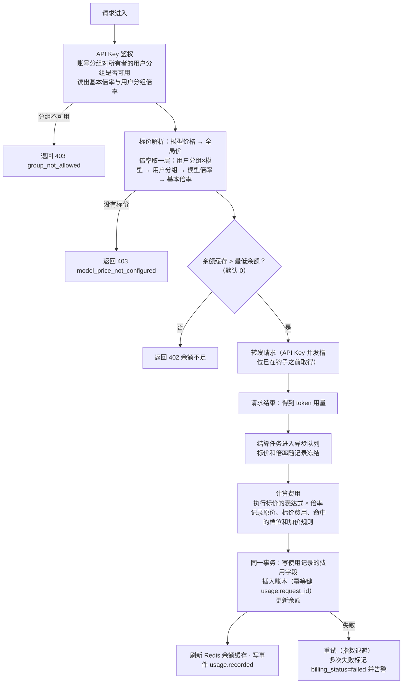

- **允许短暂透支**：余额检查在请求前，结算在请求后，同一用户的并发请求可能让余额短暂变为负数；API Key 的并发与 TPM 上限（设置时）控制了透支的幅度，余额为负后下一次请求会被拒绝
- 使用记录新增字段：`total_cost`、`rate_multiplier`、`price_id`、`expr_hash`、`billing_mode`、`matched_tier`、`billing_detail`（JSONB：各变量取值、分项费用、加价规则命中情况）、`billing_status`（pending / billed / failed / free）。2026-11-12 起另有 `base_cost`（原价）；`rate_multiplier` 存的是这次请求生效的那一层倍率；`price_id` 始终指向全局价（模型没有全局价、按账号分组的模型价格计费时为空）
- **标价与倍率在请求时定下，结算时不再解析**（CONTRACTS §97.3、§97.4）：标价和倍率在转发前解析（倍率只由 `core.RateLevels.Rate` 选出）；两者随使用记录冻结，结算、重试、对账都用冻结的值。WebSocket 每一轮用握手时的 Key 重新鉴权，标价和倍率每一轮重新解析（CONTRACTS §97.3）
- 被钩子拒绝、上游失败没有用量的请求，`billing_status=free`

---

## 8. 插件后台任务与事件订阅

### 8.1 事件

| 事件 | 触发时机 |
|---|---|
| `usage.recorded` | 使用记录写入并结算后（批量） |
| `account.created` / `account.updated` / `account.deleted` / `account.status_changed` | 账号变更、冷却、禁用 |
| `user.created` / `user.updated` | 用户变更 |
| `balance.changed` | 账本新增记录 |
| `plugin.enabled` / `plugin.disabled` | 插件状态变化 |
| `settings.changed` | 保存插件可读的系统设置分组（CONTRACTS §107） |

**投递机制（至少一次）**：

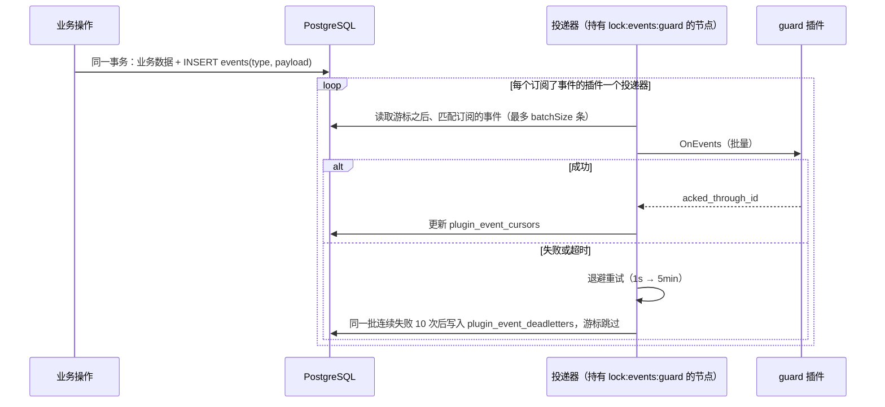

- `events(id bigserial, type, occurred_at, payload jsonb)` 是 outbox 表，与业务数据同事务写入，保证不丢
- 每个插件一个游标 `plugin_event_cursors(plugin_key, last_event_id)`；插件禁用时投递暂停、游标保留，重新启用后从断点继续
- 插件必须按事件 ID 做幂等处理
- 所有插件的游标都越过之后，事件保留 7 天后由核心清理任务删除
- 权限：订阅需要 `events` 权限，scope 限定可订阅的事件类型

**系统设置的变更通知（节点本地）**：事件只由一个节点投递给每个插件，作废不了其他节点上插件进程的缓存。所以设置另走一条路：保存设置的节点提交后广播 `config:changed` `{"key":"settings.<分组>"}`，每个节点（含写入节点）的插件发布控制器收到后，对本节点加载的插件实例（含发布中的新版本）调用 `PluginService.SettingsChanged`（SDK 自己回答，不占插件调用槽位），SDK 作废这些分组的缓存，下次 `pluginsdk.Settings` 时经 `HostService.GetSettings` 重新读库（并发调用合并成一次读，读失败时沿用上次的值）。广播丢失时 SDK 缓存最多 10 秒后过期。插件不用声明能力或权限（CONTRACTS §107.3）。

### 8.2 后台任务

上游异步生成任务使用 `endpoint.task` + `Execute` + `TaskSubmissionParser` + `TaskMonitor`（CONTRACTS §28、§112）。插件在 `Execute` 里以等待形式中继提交请求，在返回值里给 `task`，核心原子登记任务、替换预扣；核心按任务认领并调用一次 `Monitor`，插件经 `ExecuteHTTP`（SDK 的 `Fetch`）查询、把结果放在返回值里。核心固定原账号，事务性保存共享快照并结算。下表的 `jobs[]` 用于插件普通定时工作，不用于重复实现上游任务轮询；同一触发点去重也不等于不同触发点和手动执行互斥。两类后台工作共用核心执行器，保留各自触发和持久状态规则；SDK 的 `Scheduler` 只是在线请求的粘性/账号排序策略扩展，不创建后台调度器。

| 项目 | 设计 |
|---|---|
| 声明 | manifest `jobs`：`id`、`schedule`（cron 或 `@every`，不小于 5 秒）、`timeoutSec`、`scope`、`title` |
| 调度 | 0.1.237 起走定时任务框架（CONTRACTS §77.8）：`cluster` 任务（默认）是 River 全集群任务 `plugin.<key>.<id>`，每个时段全集群只跑一次；`node` 任务每个加载了插件的节点各跑一次。执行节点调用本机插件的 `AppService.RunJob`。插件还可以经 Host API 9 在运行时登记任务 |
| 保证 | 同一时段只跑一次（River 唯一键 + `scheduled_tasks` 租约 + `plugin_job_runs_slot_uniq`）；错过的触发不补跑。超时上限全集群 1 小时、每节点 10 分钟，更长的工作分段续跑 |
| 记录 | `plugin_job_runs(id, plugin_key, job_id, node_id, scheduled_at, started_at, finished_at, status, error)`，保留最近 1000 条 |
| 手动触发 | 插件详情页"立即执行"，需要 `task:run` |
| 禁用 | 插件禁用时停止调度 |

---

## 9. 插件网络：出口隧道与严格模式

### 9.1 出口隧道

```
插件进程                                            核心进程
http.Get / GORM（Host.DB）/ redis …
  → SDK 替换过的 DefaultTransport / Dialer / DefaultResolver
  → EgressService.Dial（在已有的 gRPC 连接上开一个流）══════►  确认插件身份 → 检查出口策略
                                                               → 解析 DNS → 建立连接 → 双向转发
                                                               → 记录 plugin_egress_logs
```

- SDK 在启动时替换 `http.DefaultTransport`（仍是 `*http.Transport` 类型，Clone 出来的也走隧道）、`net.DefaultResolver`，并提供 `sdk.Egress().DialContext` 给数据库、Redis、gRPC 等客户端使用
- HTTPS 在插件与目标之间端到端加密，核心只看到域名、端口和流量
- `plugin_egress_logs(id, plugin_key, node_id, host, port, started_at, duration_ms, bytes_in, bytes_out, result)`，批量写入，保留 7 天；插件详情页按域名汇总展示，出现新域名时告警
- 出口策略（每个插件单独配置）：`allow_all`（默认，只记录）或 `allowlist`（只允许批准的 `net` 域名）
- 插件访问核心的 PostgreSQL 也走隧道：拨虚拟地址 `db.sub2api:5432`，核心以插件自己的数据库身份代为登录后转发（CONTRACTS §130）
- 管理员的“插件联网”设置（全局的屏蔽列表或允许列表，CONTRACTS §113）由 `egress.Provider` 持有和缓存；它既是隧道的一道检查，也经 `core.PluginNetworkAccess` 注入网关、插件运行时和账号模块，管核心替插件发出的中继、取回、`SendAccountRequest`、配额、续期、测试与模型列表请求（§113.3）。被拒的请求同样写进 `plugin_egress_logs`

### 9.2 严格模式（Linux）

插件由核心二进制的隐藏子命令 `sub2api plugin-exec` 启动，它在 `execve` 插件之前：

1. `prctl(PR_SET_NO_NEW_PRIVS)`，设置 rlimit、`oom_score_adj`、nice（见第 10 章）
2. Landlock（CONTRACTS §43.8，默认开启）：按内核支持的版本处理全部文件权限、抽象 unix socket 与信号作用域、路径型 unix socket、严格网络下的 TCP/UDP 端口，只放行插件二进制、go-plugin 的 socket 目录、`/dev/null`、时区文件，以及获授 `fs.data` 时的数据目录、获授 `net` 时的 CA 证书
3. 加载 seccomp 规则：拒绝 `socket(AF_INET / AF_INET6 / AF_PACKET / AF_NETLINK)`、`io_uring_setup`、`ptrace`、`mount` 等；允许 `AF_UNIX`
4. `execve` 插件二进制

效果：插件只能通过 unix socket 与核心通信，**所有对外连接只能经过出口隧道**，自己建立的 TCP/UDP 连接会被内核拒绝；不申请 `fs.data` 的插件读写不了任何文件（包括同一系统用户的网关管理令牌），内核 6.12 起连不到沙箱外的抽象 socket、发不了信号，7.1 起连不到自己 socket 目录之外的路径型 socket。内核缺的层照常启动插件，核心启动时逐层记 WARN，节点页显示。不需要 root。

| 配置 | 默认值 |
|---|---|
| `plugins.sandbox.strict_network` | Linux 上为 `true` |
| `plugins.sandbox.seccomp` | Linux 上为 `true` |
| `SUB2API_PLUGIN_LANDLOCK` | Linux 上为 `true` |
| Windows / macOS | 只能运行在开发模式（`plugins.dev_mode=true`），不做严格模式 |

UDP：严格模式下禁止；插件的 DNS 查询由核心代为解析。

---

## 10. 插件资源限制

### 10.1 为什么本期不用 cgroup

目标是**防止某个插件耗尽资源、拖垮核心**。Docker 部署时，核心和所有插件进程运行在同一个容器里，共用容器的内存上限：插件内存失控时，容器触发 OOM，内核可能把核心进程杀掉，整个节点就挂了。

cgroup 可以给每个插件单独设置硬性上限，超出直接被限制，是最彻底的办法。但在容器里给子进程创建 cgroup，通常需要 `privileged` 或 systemd 委派，会降低容器本身的安全性，部署也更复杂。

下面这套不需要任何特权的组合，已经能解决主要问题，所以本期不用 cgroup，只把它作为以后运行不可信插件时的选项预留。

### 10.2 做法（都不需要特权）

| 资源 | 做法 | 效果 |
|---|---|---|
| 内存（防止拖垮核心） | 启动器把插件进程的 `oom_score_adj` 设为 1000（进程提高自己的这个值不需要特权） | 容器内存不足时，内核**优先杀插件**，核心不受影响 |
| 内存（控制用量） | 只在管理员设了上限时（插件的资源设置或节点封顶 `SUB2API_PLUGIN_MAX_MEMORY_MB`，默认都没有，CONTRACTS §111.5）：启动时设置 `GOMEMLIMIT` 为上限的 90%（Go 运行时会更积极地回收内存）；核心每 5 秒读取 `/proc/<pid>/status` 的 RSS，连续 3 次超过上限的 110% 就重启插件 | 软限制 + 超限重启；默认不限 |
| CPU | 启动器把插件的 nice 值调高 10（调低优先级不需要特权） | CPU 紧张时核心优先；插件 CPU 使用率会统计展示，持续占满时告警 |
| 文件数 | `RLIMIT_NOFILE` | 硬限制 |
| 线程数 | 读取 `/proc/<pid>/status` 的 Threads | 超过申请值时告警 |
| 调用层面 | 每个插件的并发上限、每次调用的超时、钩子熔断 | 防止插件拖慢请求 |

- 插件在 manifest `resources` 中申请；管理员可以在插件设置里调整；设了全局上限时，超出的申请在安装时被拒绝。内存例外：manifest 的 `memoryMB` 只是自述的需要，不是上限，内存只有管理员设置时才受限（CONTRACTS §111.5）
- 插件崩溃或因超限被重启时按指数退避重启（1s → 60s）；10 分钟内重启超过 5 次，就标记插件在该节点不可用并告警
- 插件详情页显示每个节点上的内存、CPU、线程数、重启次数和重启原因

---

## 11. 插件签名、信任与插件市场

### 11.1 签名

```jsonc
// signature.json
{
  "publisher": "sub2api",
  "keyId": "sub2api-2026-01",
  "algorithm": "ed25519",
  "digest": "sha256:...",     // 对"manifest.json 的 sha256 + 其余所有文件按路径排序后的 sha256 列表"再做 sha256
  "signature": "base64..."
}
```

- 校验：上传时重新计算 digest，用发布者公钥验证签名；插件包内任何文件被改动都会导致校验失败
- 插件包不存 PG（PG 只记 `package_sha256`）：节点从市场或从持有它的其他在线节点取回插件包（MULTINODE-SYNC-PROTOCOL §6.2）后，按 sha256 校验，启动前再验一次签名（从市场安装的版本不验签，只查发布者未被吊销，CONTRACTS §136）

### 11.2 信任体系

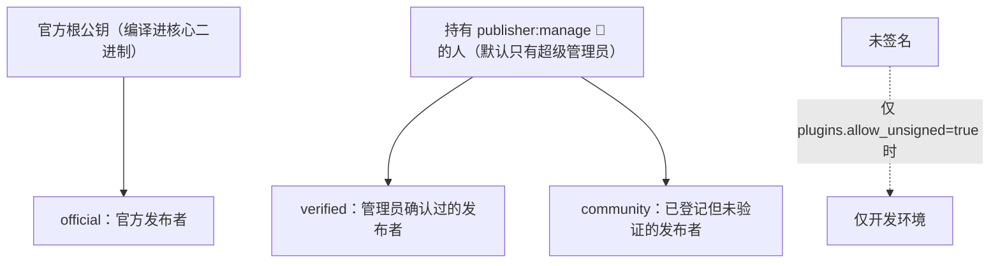

| 信任级别 | 可申请的权限 | 原生微前端 |
|---|---|---|
| official | 全部 | ✅ |
| verified | 全部（极高风险仍需逐项确认） | ✅ |
| community | 不能申请 🔴 极高风险权限 | ❌ |
| 未签名 | 同 community，且仅限开发环境 | ❌ |

- `publishers(id, name, trust_level, status)`、`publisher_keys(key_id, publisher_id, public_key, status, not_before, not_after)`
- **吊销**：发布者或密钥被吊销时，由其签名的插件立即标记为"签名已吊销"；按配置自动禁用（默认）或只告警
- 密钥轮换：同一发布者可以有多把有效密钥

### 11.3 插件市场（本期只做客户端）

- 商店与频道（CONTRACTS §137.6）：商店是登记处的 GitHub 仓库（`market_stores`），只有官方商店 touwaeriol/sup2api-plugin（2026-11-24 用户定只有官方仓库能做商店，表留着以后扩展）；频道是仓库的分支（`market_sources`，可增删改），索引在 `https://raw.githubusercontent.com/<仓库>/index-<分支>/index.json`（地址读时推出，不存库），一个默认频道；只接受 HTTPS，包只从 GitHub Release 下载（`SUB2API_MARKET_BASE_URL` 只给测试栈与本地开发把官方商店指向本地市场）；索引是一个**不签名的静态 JSON 文件**（index.json v2，CONTRACTS §11.1），由登记处仓库 touwaeriol/sup2api-plugin 经 PR 审核（`sub2api-plugin registry check`）后 CI 用 `sub2api-plugin index` 生成（CONTRACTS §135）：发布者（信任级别、状态）、插件、版本、GitHub Release 下载地址、sha256、弃用标记
- 控制台"插件市场"页：先选商店再选频道，浏览、按发布者筛选、一键安装（下载 → 按索引校验大小与 sha256 → 进入授权确认）、检查已安装插件的更新（弃用的版本不算更新）
- 可信来源是登记处仓库的审核与 HTTPS：没有索引签名，也没有市场公钥；从市场安装的包不看包签名，信任级别取自索引里发布者的 `trust`，记在这个版本上（`plugin_versions.trust_level`），不改本地发布者；发布者被吊销或不在索引中时拒绝安装；插件 id 相同即可从商店升级（CONTRACTS §136）

### 11.4 开发工具

`sub2api-plugin` 命令行：`keygen`（生成发布者密钥）、`build`（交叉编译 linux/amd64、linux/arm64，`--dev` 额外编译本机平台）、`pack`、`sign`、`verify`、`index`（从索引登记处生成市场索引，`--dev` 用于本地市场）、`registry check|add-version|codeowners|import`（审核登记处的 PR、从 GitHub Release 写版本文件、生成 CODEOWNERS、登记本地包，CONTRACTS §135）。

---

## 12. 前端

### 12.1 控制台

Vue 3 + Vite + TypeScript + Pinia + Vue Router + Tailwind。菜单、路由权限、按钮权限全部由后端数据驱动：

- `GET /api/me`：用户信息、权限集合
- `GET /api/me/menus`：核心菜单 + 已启用插件的菜单（已按权限过滤）。插件菜单可进共享的"插件"区、追加到某个核心区，或放进插件自己声明的区（manifest `ui.sections`，按 `order` 与核心区穿插；CONTRACTS §22）
- `GET /api/ui/plugins`：已启用插件的前端扩展声明（页面、插槽、原生入口地址）

### 12.2 插件界面的两种方式

（2026-11-19 起，插件界面只用代码写：原来的第三种方式 schema——插件提供 JSON Schema / 表格定义、核心渲染——已删除，账号表单与设置的校验只在插件后端（`ValidateCredentials`、`ValidateSettings`），见 CONTRACTS §23、§75.1。）

| 方式 | 适用 | 安全 | 说明 |
|---|---|---|---|
| **iframe** | 复杂但不受信的界面 | 沙箱隔离，拿不到登录态 | `sandbox="allow-scripts"`；通过 Bridge 调用插件接口（核心代为携带会话）、同步主题和语言、路由、提示框 |
| **原生微前端** | 受信插件的复杂界面、嵌入核心页面 | **无隔离**，只允许 official / verified 且获批 `ui.native` | 插件的 Vue 组件直接挂进控制台 |

### 12.3 原生微前端

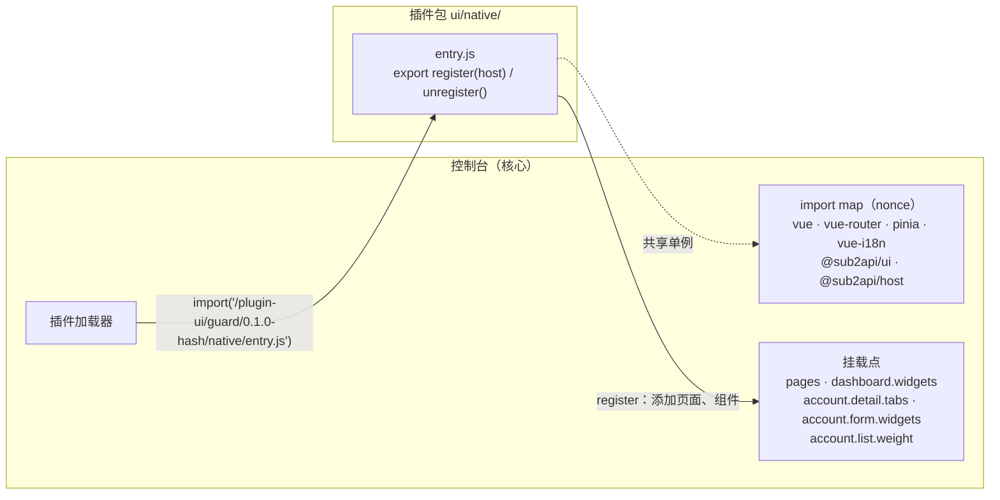

- 核心构建时把 Vue 等公共依赖和 `@sub2api/ui`（组件库）、`@sub2api/host`（宿主 API：带会话的请求、路由、i18n、权限、提示框）输出为独立的 ES 模块，用 import map 暴露；**核心自己也从这些模块导入**，保证单例
- 插件用官方 Vite 预设构建（这些依赖设为 external），体积小
- URL 带版本号和 hash，升级后自动加载新文件
- 禁用插件时调用 `unregister()`、移除路由和挂载点上的组件；已加载的模块在刷新页面后释放
- `hostUICompat` 不兼容的插件拒绝加载
- CSP 不需要放宽（插件脚本与控制台同源）

---

## 13. 用户 / 角色 / 权限

### 13.1 模型

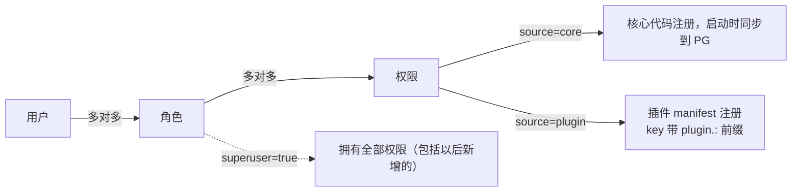

### 13.2 鉴权判断

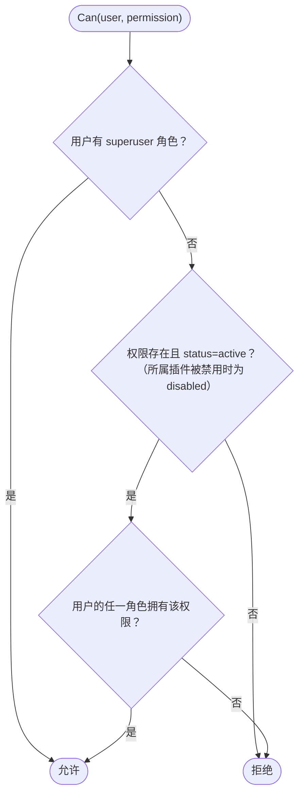

- 权限判断由每个节点的 Casbin enforcer 作出（`SyncedCachedEnforcer`，内存里有 active 权限的授予、超管行，用户的角色在第一次被问到时按需读入、有上限，CONTRACTS §99.3）：`Can` 是 `Enforce`（经决策缓存），用户的授予列表是 `GetImplicitPermissionsForUser`。变更时广播 `authz:changed`，**收回立即生效**：只改某个用户角色或状态的写入只让各节点在内存里换掉这个用户的角色、作废他的决策；改授予、权限状态、角色定义的写入推进策略版本，各节点重新装入授予，保留已读入的用户（CONTRACTS §99.4）
- 会话只记用户 ID 与 `token_version` 盖章，不带权限（CONTRACTS §100.1）
- `sensitive` 只是高危标记（角色编辑器提示用）；**已取消二次验证**（2026-10-05 用户决定，CONTRACTS §3.3），任何操作只看登录态和权限

### 13.3 内置角色与核心权限

| 角色 | 说明 |
|---|---|
| `super_admin` | superuser，至少保留一个用户，不能删除 |
| `admin` | 默认拥有除超管专属权限（CONTRACTS §4 标 👑 的 5 项）以外的全部核心权限，可修改（内置角色只有超级管理员能改） |
| `user` | 管理自己的 API Key、查看自己的用量和余额流水、调用网关 |

| 模块 | 权限 |
|---|---|
| 用户 | `user:read` `user:create` `user:update` `user:delete` |
| 角色 | `role:read` `role:define` `role:assign` |
| API Key | `apikey:self:manage` `apikey:all:read` `apikey:all:manage` |
| 账号分组 | `group:read` `group:manage` |
| 用户分组 | `segment:read` `segment:manage`（7.1，CONTRACTS §97.7） |
| 账号 | `account:read` `account:create` `account:update` `account:delete` `account:test` `account:credential:view`🔐；只作用于自己创建的账号：`account:own:read` `account:own:create` `account:own:update` `account:own:delete` `account:own:test` `account:own:credential:view`🔐；`account:settings:custom`（允许受限设置如 base_url 用官方地址以外的值） |
| 代理 | `proxy:read` `proxy:manage`；只作用于自己创建的代理：`proxy:own:read` `proxy:own:manage` |
| 价格 | `price:read` `price:manage` |
| 余额 | `balance:self:read` `balance:all:read` `balance:adjust`🔐 |
| 使用记录 | `usage:self:read` `usage:all:read` |
| 插件 | `plugin:read` `plugin:install`🔐 `plugin:manage` `plugin:uninstall`🔐 `plugin:grant:high` `plugin:grant:critical`🔐 `plugin:egress:read` `plugin:market:read` |
| 发布者 | `publisher:read` `publisher:manage`🔐 |
| 集群 | `node:read` |
| 网关 | `gateway:use` |

🔐 = 敏感（高危）权限，仅作提示；操作时不再要求输入密码（CONTRACTS §3.3）。

**所有权**（CONTRACTS §21）：账号与代理都记录 `created_by`；`*:own:*` 权限只作用于自己创建的资源，同一路由接受全部级或自己级任一 key（`Router.PermAny`），范围条件落在 SQL 里，越权一律 404；`created_by` 为空的历史数据只有全部级可见。所有权只约束控制台 API，不影响网关调度。

### 13.4 插件权限的生命周期

| 操作 | 权限定义 | 角色上的授权 |
|---|---|---|
| 安装 | 插入，status=active | 默认不授予；安装确认时可选择授予哪些角色 |
| 升级 | 新增的插入，删除的连同授权删除，保留的不变 | 保留的不变 |
| 禁用 | status=disabled，**不删除** | 保留，但判断时视为没有 |
| 重新启用 | status=active | 立即恢复 |
| 卸载 | **删除**（外键级联） | 随之删除 |

---

## 14. 其他关键流程

### 14.1 账号录入

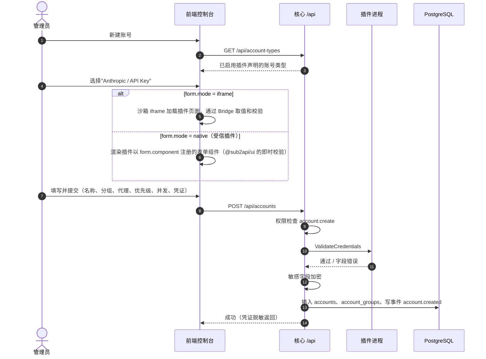

### 14.2 插件安装

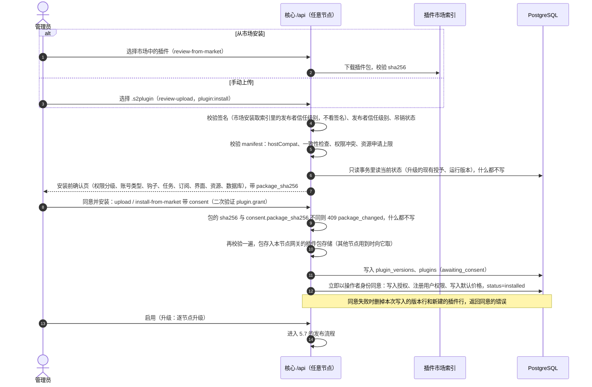

不带 `consent` 的上传与市场安装仍是两步：先登记为 `awaiting_consent`，再 POST consent（脚本、e2e 用；CONTRACTS §5.7“先授权再安装”）。

---

## 15. 两个演示插件

### 15.1 anthropic（账号类型插件，内置）

anthropic 平台及其端点、用量规则、默认粘性规则由**核心内置**（`sdk/platforms/anthropic.json`，见 6.6）；插件本身随镜像内置、只能禁用不能卸载。

| 能力 | 内容 |
|---|---|
| 账号类型 | `apikey`：支持平台 `anthropic`；字段 `api_key`（敏感）、`base_url`（默认 `https://api.anthropic.com`）、`model_mapping` |
| 构造请求 | `Execute`（`sdk/pluginsdk/standard` 加 anthropic 预设）：按 `meta.protocol` 选上游路径 `base_url + /v1/messages` 或 `/v1/messages/count_tokens`；`x-api-key` 是权威头，`anthropic-version`（客户端没带时默认 `2023-06-01`）、`anthropic-beta`（透传）是默认头；请求体是核心改写（含模型映射）之后的，原样交回 |
| 错误分类 | 400 直接返回；401/403 切换并禁用账号；429 切换并冷却到 `retry-after`（默认 60 秒）；529 切换并冷却 30 秒；5xx 切换并冷却 10 秒 |
| 数据 | 不用数据库、不提供插件接口和用户权限（0.4.0 删除了模型目录，CONTRACTS §129） |
| 升级演示 | 测试版本 `0.4.1-test`（`testdata/upgrade`，只改版本号）在流量下升级，验证切换期间请求不中断；带迁移的升级由 dynweight 的测试版本 `0.6.1-test` 演示（`0004_config_rule_count.sql`，加字段并回填已保存的配置） |
| 权限 | `platform.register`、`ui.native` |

另有市场插件 **relay（Claude 中转）**：只声明账号类型 `relay_key`（支持平台 `anthropic`，按平台覆盖 passHeaders），演示多个插件的账号类型在同一分组中共同服务 `/v1/messages`。

### 15.2 guard（钩子与应用插件）

| 能力 | 内容 |
|---|---|
| 网关钩子 | `gateway.request`：从 `prompt_text` 中匹配拦截规则（关键词、正则），命中返回 403；`failure=open`、超时 300ms |
| 规则管理 | 规则存在 `plg_guard__rules`；接口 `GET/PUT /rules`；插件在内存中缓存规则，规则更新后立即生效 |
| 事件订阅 | `usage.recorded`：按分钟统计各分组、模型的请求量，写入 `plg_guard__stats_minutely` |
| 后台任务 | `rollup` 每 5 分钟把分钟统计汇总为小时统计；`cleanup` 每天清理 30 天前的数据 |
| 出口访问 | 命中规则时向配置的 webhook 地址发送告警（`http.Post`，经出口隧道，能在"外部访问"页看到） |
| 原生界面 | "请求守卫"大盘页面（拦截趋势图、规则命中排行）+ 首页的"今日拦截"卡片 |
| 设置 | 原生设置组件 `GuardSettings`（`ui.settings.mode: native`）：webhook 地址、冷却时间等，保存时由插件 `ValidateSettings` 校验 |
| 资源 | 申请 128MB 内存、0.25 核 |
| 用户权限 | `rules:read`、`rules:manage`、`stats:read` |
| 测试用途 | 另有一个测试构建，会尝试直接 `net.Dial` 外部地址和申请超量内存，用来验证严格模式和资源限制 |

---

## 16. 代码仓库与技术选型

### 16.1 旧代码备份与新代码位置

- 备份：打 tag `legacy/v0.2.8`，创建分支 `legacy/main`，旧代码原样保留
- 新代码：`next/` 目录，与仓库根目录的旧代码（`backend/`、`frontend/`）并存。开发分支是 `develop`（早期的 `feat/next-platform` 已不再使用），新工作从 `develop` 开分支，完成后合回 `develop`

### 16.2 目录结构

```
next/
├── go.work                        # Go 工作区：下列每个 Go module（CONTRACTS §2）
├── server/                        # 核心服务 sub2api（独立 Go module）
│   ├── cmd/
│   │   ├── sub2api/main.go        # 含 dev 子命令与隐藏子命令 plugin-exec（启动器）
│   │   ├── gen-models/            # 由迁移生成 GORM 模型（store/model）
│   │   └── convert-record/        # 协议转换黄金样例录制工具（手动运行）
│   ├── internal/
│   │   ├── app/  config/  core/  store/  migrations/  cluster/  task/  job/  event/
│   │   ├── iam/  authz/  apikey/  group/  proxy/  account/  billing/  usage/  ...
│   │   ├── gateway/               # 流水线、调度、钩子执行、用量提取；convert/ 是协议转换
│   │   ├── plugin/                # 包、签名与信任、manifest、授权、迁移、注册表、发布、市场
│   │   │   ├── grpcruntime/       # 唯一允许引用 go-plugin 的包；HostService、EgressService
│   │   │   └── sandbox/           # Landlock、seccomp、rlimit、oom_score_adj、nice、看门狗（//go:build linux）
│   │   └── httpapi/               # gin 路由、handler、中间件
│   └── web/                       # 嵌入前端构建产物（dist/index.html 是被跟踪的占位文件）
├── gateway/                       # 节点外壳（独立 Go module）
│   ├── cmd/sub2api-gateway/       # 公网入口、本机核心的 supervisor、托管升级、节点间转发
│   ├── cmd/sub2api-release/       # 核心与网关清单的打包（pack、pack-gateway）、镜像源（mirror）、插件公钥（pubkey）
│   └── internal/                  # control、supervisor、proxy、peer、release、updatesource、pluginblob、sqlguard ...
├── runtime-contract/              # 外壳与核心的协议；gormpg（共用的数据库层与 sqlcheck）、sqlpool、locklease
├── sdk/                           # 插件 SDK（独立 Go module，插件只依赖它和 runtime-contract）
│   ├── proto/sub2api/plugin/v1/*.proto
│   ├── gen/  manifest/  protocol/  pkgsig/
│   ├── pluginsdk/                 # Serve()、Host 客户端、出口隧道 Transport/Dialer/Resolver、测试工具
│   ├── pgdb/                      # 插件的 GORM 句柄、组合器、TestNoRawSQL/TestNoPgxImports
│   └── testpg/                    # 测试用 PostgreSQL（TEST_DATABASE_URL 或本机 embedded-postgres）
├── plugins/                       # 官方插件，每个是独立 Go module；版本登记在 touwaeriol/sup2api-plugin
│   ├── anthropic/  openai/  gemini/  relay/
│   ├── codex/                     # 含 ui/native
│   ├── dynweight/  guard/  moderation/   # 含 ui/native
│   └── mailer/  payment/
├── protocol-codec/                # 早期的协议转换库；next/ 内无人引用，只剩旧版 backend/ 依赖
├── tools/
│   └── sub2api-plugin/            # keygen / build / pack / sign / verify / index / registry / db diff|check / dev
├── e2e/                           # 验收测试（需要部署好的 e2e 栈；CI 只编译）
├── web/                           # 控制台（Vue 3）
│   ├── src/
│   └── packages/
│       ├── ui/                    # @sub2api/ui 组件库（共享给原生插件）
│       ├── host/                  # @sub2api/host 宿主 API
│       └── vite-preset/           # 插件前端构建预设
├── deploy/                        # 镜像构建脚本（docker/）、网关托管部署（gateway/）、单机栈（single/）、
│                                  # e2e 栈（e2e/）、mock-upstream、单向发布进行中的发布与回退手册（rollback/，平时没有）
├── Dockerfile                     # 核心、插件与控制台的镜像构建
└── docs/
```

### 16.3 技术选型

| 项目 | 选择 |
|---|---|
| 语言 | Go 1.27 |
| HTTP | gin |
| 数据库 | PostgreSQL 16 + GORM（驱动是 pgx v5 的 `stdlib`，连接池是 `database/sql`；打开连接、GORM 没有形式的薄组合器（`EXISTS`、`INSERT ... SELECT`、`nextval`、`to_regclass`、事务级 advisory 锁）和 SQL 文本检查器 `gormpg/sqlcheck` 由 `runtime-contract/gormpg` 一处实现，核心、网关、插件 SDK 共用）；语句由 GORM 的模型与查询构造器生成，值只走 `?` 参数，`Raw`/`Exec` 只组合已生成的查询；整条手写的只剩账本的 data-modifying CTE、网关心跳的 CTE 与 schema 脚本，以及锁、DDL、序列、系统目录的小助手（核心 gormguard、SDK 的 `TestNoRawSQL`、网关 `sqlguard` 用同一个 `sqlcheck` 检查，CONTRACTS §2、§39）。表结构以 SQL 迁移为准：核心的模型由迁移生成（`store/modelgen`），插件的模型由 `sub2api-plugin db check` 对照迁移；运行时不跑 AutoMigrate。插件只拿到 `Host.DB` 的 `*gorm.DB`（CONTRACTS §2） |
| 权限判断 | Casbin v3（策略存 `casbin_rule`，gorm-adapter 的列布局，adapter 只用来读入；每个节点一个 `SyncedCachedEnforcer`，带 Casbin 的角色管理器与决策缓存；装入时只读授予，用户的角色在第一次判断时按需读入、有上限；策略版本变化时原地重载授予或换一个新的 enforcer，只改用户角色或状态时只换该用户，CONTRACTS §99.3–99.4） |
| 迁移 | 嵌入式 SQL + 自研执行器（核心和插件共用，参考旧项目 `migrations_runner.go`） |
| 缓存 / 实时状态 | Valkey（或 Redis 7+）+ go-redis v9；控制台会话 `s2s_` 也只存在这里（CONTRACTS §100） |
| 插件 | hashicorp/go-plugin + gRPC + protobuf |
| seccomp | elastic/go-seccomp-bpf（纯 Go，不需要 cgo） |
| 签名 | crypto/ed25519 |
| JSON | gjson / sjson；santhosh-tekuri/jsonschema 只用于校验账号类型的 `extensionsSchema`（`server/internal/account/extensions.go`） |
| 金额 | numeric(20,8) + shopspring/decimal |
| 计费表达式 | expr-lang/expr（MIT）；设计参考 new-api 的 billingexpr，代码自行实现（new-api 是 AGPL-3.0，不能直接复制） |
| 定时任务 | 定时任务框架（CONTRACTS §77）：`node` 任务用 gocron v2，`cluster` 任务用 River（`database/sql` 驱动，只轮询，新任务最多等 1 秒被取走）；robfig/cron v3 只负责解析 cron 表达式 |
| 日志 | log/slog |
| 前端 | Vue 3 + Vite + TypeScript + Pinia + Vue Router + Tailwind；图表用 ECharts |
| 依赖注入 | 手写组装 |
| 运行平台 | 生产仅 Linux（含 Docker）；Windows/macOS 仅插件开发模式 |

---

## 17. 实施计划与 Agent 团队

### 17.1 阶段

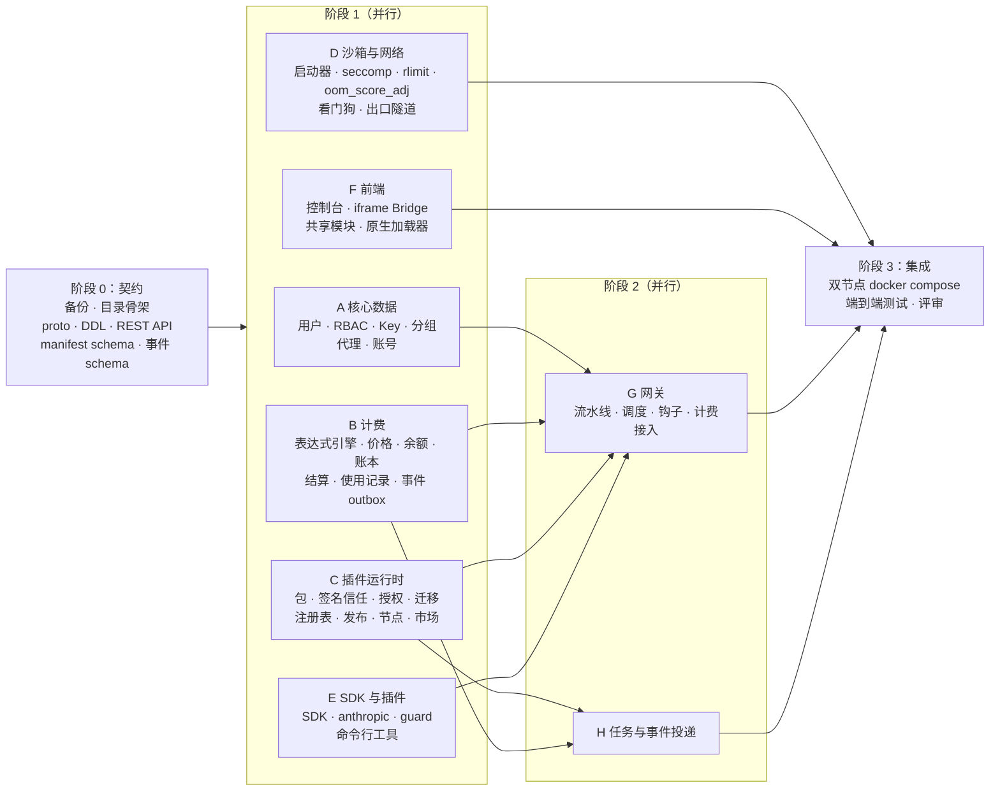

阶段 0 的契约是所有 agent 共同依赖的，由主控先完成并冻结；契约变更必须经过主控。

### 17.2 团队分工

| Agent | 负责 | 交付物 |
|---|---|---|
| 主控 | 阶段 0 契约、任务拆分、合并、跨模块评审 | proto、DDL、OpenAPI、manifest / 事件 schema |
| A core-data | `iam` `authz` `apikey` `group` `proxy` `account` | 模块、接口、单元测试 |
| B billing | `billing`（含计费表达式引擎）`usage` `event`（outbox 写入端） | 模块、表达式引擎与冒烟测试、结算与幂等测试 |
| C plugin-runtime | `plugin`、`grpcruntime`、`cluster` | 模块、生命周期与发布测试 |
| D sandbox-network | `sandbox`、EgressService、SDK 网络部分 | 启动器、隧道、限制测试 |
| E sdk-plugins | `sdk`、`plugins/anthropic`、`plugins/guard`（后端）、`tools/sub2api-plugin` | SDK、两个插件及测试构建 |
| F frontend | 控制台全部页面、`@sub2api/ui`、`@sub2api/host`、原生加载器、guard 原生界面 | 前端工程 |
| G gateway | `gateway` | 流水线、钩子、计费接入、压测 |
| H events-jobs | `event`（投递端）、`job` | 投递器、调度器、测试 |
| QA | docker compose、端到端测试、多节点测试 | 测试脚本与报告 |

### 17.3 验收标准

**基础**
1. `docker compose up` 启动 PG、Redis、两个节点和 Caddy
2. 超级管理员创建角色"运营"（只有账号、代理权限）并分配给新用户，该用户只能看到对应菜单，调用其他接口返回 403

**插件与平台**
3. 从市场索引安装 anthropic（签名为 official）→ 确认授权 → 启用 → 两个节点均为 active；经 anthropic 账号分别发往两个节点的请求都成功，上游收到插件构造的请求
4. 新建账号：选择"Anthropic / API Key"→ 插件提供的录入界面 → 保存成功、凭证脱敏
5. 在流量下把 anthropic 与 dynweight 升到测试版本：两个节点切换期间请求不中断；dynweight 的迁移执行一次，升级前保存的配置仍在并已回填
6. 禁用插件：账号保留、插件权限变灰、其端点消失（404）；重新启用恢复；内置插件不能卸载

**分组与计费**
7. 用户在自己可用的分组下创建 Key，调用 `/v1/messages`（流式和非流式）成功，只调度到该分组的账号
8. 分别配置按次、按 token、两档表达式（含一条请求头加价规则）三种价格：使用记录中的费用、命中档位、加价规则与价格试算结果一致；账本有对应记录；同一请求重复结算不会重复扣款
9. 余额不足返回 402；管理员调整余额后可以继续使用，账本记录操作人

**钩子、事件、任务**
10. guard 规则命中时返回 403 且不调用上游；guard 进程被杀死时按 `failure=open` 放行，并触发熔断
11. guard 通过事件订阅统计到的请求数与使用记录一致；禁用后重新启用，事件从断点继续投递
12. guard 的 `rollup` 任务在两个节点的环境下每个周期只执行一次

**网络、资源、签名、界面**
13. guard 发出的 webhook 告警出现在"外部访问"页；测试构建直接 `net.Dial` 失败
14. 测试构建超量申请内存被重启，插件详情页显示重启原因；容器内存不足时被杀的是插件而不是核心；超过全局上限的资源申请在安装时被拒绝
15. 篡改插件包中任一文件后安装失败；吊销发布者后其插件被自动禁用；community 发布者申请 `ui.native` 被拒绝
16. guard 的原生大盘页面和首页卡片正常显示；禁用 guard 后页面和卡片消失

**多节点**
17. 停掉一个节点：15 秒内从节点列表消失，它留下的并发槽位在下一轮回收时清理（回收周期 30 秒，最长约 45 秒），另一个节点正常服务

---

## 18. 决策记录与待确认事项

### 18.1 已确认

| # | 问题 | 决定 |
|---|---|---|
| 1 | 新代码位置 | 当前仓库的 `next/` 目录 |
| 2 | 模型价格 | 独立页面，支持按次、按 token、按表达式；参考 new-api 的设计自行实现 |
| 3 | 充值方式 | 本期只支持管理员调整余额 |
| 4 | cgroup | 本期不用；采用不需要特权的组合（第 10 章），cgroup 预留 |
| 5 | 签名密钥 | 官方根密钥由你们保管，开发环境生成测试密钥；市场索引先放 GitHub Releases |

### 18.2 采用默认建议（如有不同意见请指出）

| # | 问题 | 默认做法 |
|---|---|---|
| 6 | 计费币种和精度 | USD，`numeric(20,8)` |
| 7 | 找不到模型价格 | 拒绝请求（2026-11-19 起不能再配置为免费放行，CONTRACTS §17.3） |
| 8 | 最低余额和透支 | 最低余额 0，允许短暂透支（受 API Key 并发上限约束） |
| 9 | 旧系统数据 | 本期不导入 |
| 10 | 敏感操作的二次验证 | ~~本期再次输入密码，以后换成 TOTP~~ 已取消（2026-10-05 用户决定）：只看登录态与 RBAC 权限，CONTRACTS §3.3 |
| 11 | 前端风格 | 沿用旧项目的 Tailwind 风格，组件重新写 |
| 12 | 计费代码的来源 | 只参考 new-api 的设计，不复制代码（许可证原因） |

---

## 附录 A：控制台界面线框图

图中用 `[核心]` 和 `[插件]` 标出内容由谁提供。

### A.1 整体布局（菜单按权限显示）

侧栏现在的分组和各项位置以 CONTRACTS §90 为准；下图是早期布局（分组、模型价格现在在系统设置视图里，模型目录菜单已删除）。

```
┌──────────────────────────────────────────────────────────────────────────┐
│ sub2api                                  余额 $12.34   admin@x.com ▾  中 │
├──────────────┬───────────────────────────────────────────────────────────┤
│ 概览         │  ┌ 今日请求 ┐ ┌ 今日费用 ┐ ┌ 可用账号 ┐ ┌ 今日拦截 [插件] ┐│
│ ── 网关 ──   │  │  12,345  │ │  $86.20  │ │   8/10   │ │   37 ▲12%        ││
│ 分组         │  └──────────┘ └──────────┘ └──────────┘ └──────────────────┘│
│ 账号         │    ↑ "今日拦截"是 guard 插件注册到 dashboard.widgets 的原生组件
│ 代理         │                                                           │
│ 模型价格     │                                                           │
│ 概览         │  ← 全部用户的合计卡片与图表（CONTRACTS §66.7）             │
│ 使用记录     │  ← 六项统计（含实时 RPM、TPM）与请求列表                   │
│ ── 系统 ──   │                                                           │
│ 用户         │                                                           │
│ 角色与权限   │                                                           │
│ 插件         │                                                           │
│ 插件市场     │                                                           │
│ 发布者       │                                                           │
│ 集群节点     │                                                           │
│ ── 我的 ──   │                                                           │
│ API Key      │                                                           │
│ 模型与价格   │  ← 自己分组能用的模型和实际价格                           │
│ 钱包         │  ← 余额、消费和余额变动                                   │
│ 个人中心     │  ← 资料、密码、二次验证、通行密钥、登录会话               │
│ 概览         │  ← 自己的请求量、Token、费用（合计卡片与图表）             │
│ 使用记录     │  ← 自己的请求记录；「余额变动」类型是自己的余额与流水      │
│ ── 插件 ──   │  ← [插件] 菜单，按权限显示                                │
│ 模型目录     │                                                           │
│ 请求守卫     │                                                           │
└──────────────┴───────────────────────────────────────────────────────────┘
```

### A.2 账号列表 `[核心]`

```
账号                                                        [ + 新建账号 ]
 平台 [全部 ▾]  分组 [全部 ▾]  状态 [全部 ▾]  搜索 [____________]
┌────┬──────────────┬──────────────────┬──────────┬──────┬──────┬───────┬────────────┐
│ ID │ 名称         │ 类型              │ 分组     │ 状态 │ 优先 │ 并发  │ 操作       │
├────┼──────────────┼──────────────────┼──────────┼──────┼──────┼───────┼────────────┤
│ 12 │ claude-main  │ Anthropic·API Key │ 默认,VIP │ ● 正常│  1  │ 3/10  │ 测试 编辑 ⋯│
│ 13 │ claude-bak   │ Anthropic·API Key │ 默认     │ ◐ 冷却│  2  │ 0/10  │ 测试 编辑 ⋯│
│    │              │                  │          │ 至 14:05（429）                  │
│ 14 │ old-key      │ Anthropic·API Key │ 默认     │ ✕ 禁用（401 凭证无效）           │
└────┴──────────────┴──────────────────┴──────────┴──────┴──────┴───────┴────────────┘
```

### A.3 新建账号 第 1 步：选择账号类型 `[插件]`

```
新建账号 · 选择类型                                                    ✕
┌──────────────────────────────────────────────────────────────────────┐
│  ┌─────────────────────┐   ┌─────────────────────┐                   │
│  │ [A] Anthropic       │   │ [?] 其他平台         │  ← 每个已启用插件 │
│  │     API Key         │   │   （安装插件后出现） │    声明的账号类型 │
│  │ anthropic v0.1.0    │   │                     │                   │
│  └─────────────────────┘   └─────────────────────┘                   │
│  没有需要的平台？前往"插件市场"安装                                   │
└──────────────────────────────────────────────────────────────────────┘
```

### A.4 新建账号 第 2 步：填写信息

```
新建账号 · Anthropic / API Key                                  ← 上一步  ✕
┌──────────────────────────────────────────────────────────────────────┐
│ 基本信息                                                  [核心]     │
│   名称 [claude-main        ]   分组 [默认 ✕][VIP ✕][+]               │
│   代理 [不使用代理        ▾]                                          │
│ 调度                                                      [核心]     │
│   优先级 [1]  权重 [1]  最大并发 [10]  ☑ 参与调度                     │
│ 限流（0 = 不限）                                          [核心]     │
│   RPM [0]  TPM [0]  SPM [0]                                           │
│ 模型                                                      [核心]     │
│   模型列表 [claude-sonnet-4-5 ✕][claude-opus-4-1 ✕][+]  空 = 全部    │
│   模型映射 [claude-3-5-sonnet-latest → claude-sonnet-4-5] [+] [JSON] │
├──────────────────────────────────────────────────────────────────────┤
│ 凭证                                                      [插件]     │
│   API Key * [ sk-ant-••••••••••••••••••      ] 👁                     │
│   Base URL  [ https://api.anthropic.com    ▾ ]                       │
│   （iframe 或原生组件，由插件决定）                                  │
├──────────────────────────────────────────────────────────────────────┤
│                               [ 测试连接 ]  [ 取消 ]  [ 保存 ]       │
└──────────────────────────────────────────────────────────────────────┘
```

### A.5 分组 `[核心]`

```
分组                                                          [ + 新建分组 ]
┌──────┬──────────┬──────┬──────────────┬──────────┬──────────┬──────────┐
│ 名称 │ 可见性   │ 倍率 │ 模型白名单   │ 账号数   │ Key 数   │ 操作     │
├──────┼──────────┼──────┼──────────────┼──────────┼──────────┼──────────┤
│ 默认 │ 公开     │ 1.00 │ 不限         │ 8        │ 120      │ 编辑 ⋯   │
│ VIP  │ 私有     │ 0.80 │ claude-*     │ 3        │ 12       │ 编辑 ⋯   │
└──────┴──────────┴──────┴──────────────┴──────────┴──────────┴──────────┘
```

### A.6 模型价格 `[核心]`

**列表**

```
模型价格                   来源 [全部 ▾]  方式 [全部 ▾]  搜索 [________]   [ 同步价格 ] [ + 新增价格 ]
┌──────────┬──────────────────┬────────┬───────────────────────────────────────┬────────────┬──────┐
│ 模型              │ 方式   │ 摘要                                  │ 来源             │ 操作 │
├──────────┼──────────────────┼────────┼───────────────────────────────────────┼────────────┼──────┤
│ claude-sonnet-4-5 │ 按token│ 输入 $3 · 输出 $15 … · 共 2 档          │ 同步 · LiteLLM   │ 编辑 │
│ claude-haiku-4-5  │ 按token│ 输入 $1 · 输出 $5 · 缓存读 $0.1 /百万  │ 同步 · LiteLLM   │ 编辑 │
│ claude-sonnet-x   │ 按token│ 共 2 档 · 1 条加价规则                 │ 手动             │ 编辑 │
│ web-search        │ 按次   │ $0.01 / 次                             │ 手动             │ 编辑 │
└──────────┴──────────────────┴────────┴───────────────────────────────────────┴────────────┴──────┘
修改同步来的价格后它变为手动价格；"同步价格"进入同步源页面预览并选择导入
```

**编辑**（2026-11-21，设计见 [DESIGN-2026-11-21-BILLING-MODES.md](DESIGN-2026-11-21-BILLING-MODES.md)；左边编辑，右边一栏是校验与试算，宽屏时固定）

```
编辑价格 · claude-sonnet-x                                           [取消] [保存]
┌ 计费方式 ─────────────────────────────────────────┐ ┌ 校验 ────────────────────┐
│ [ 按次 ]  [• 按 token ]  [ 表达式 ]               │ │ ✓ 编译通过，冒烟测试通过 │
│ 价格档位（按 len 从上往下匹配）    [从模板开始 ▾] │ └──────────────────────────┘
│ ① standard   len ≤ [200000]          [按 token ▾] │ ┌ 价格试算 ────────────────┐
│   输入[3] 输出[15] 缓存读[0.3] 写5m[3.75] 写1h[6] │ │ 输入 输出 缓存读 …       │
│   缓存写 (一种价|分 5 分钟/1 小时)  □ 图片单独计价 │ │ ▸ 请求头、参数、用量字段 │
│ ② long_context  len > 200,000（以上都不满足时）   │ │ $0.354   档位 standard   │
│   输入[6] 输出[22.5] …                            │ │ ✕ fast-mode ×2  明细 …   │
│ [+ 添加档位]                                      │ └──────────────────────────┘
│ 加价规则                             [+ 添加规则] │
│  priority 实际生效                     命中后 ×[2]│
│   当 [请求参数▾] service_tier [等于▾] priority    │
│   且 [用量字段▾] service_tier [等于▾] priority    │
│ ▸ 查看生成的表达式（可“改用表达式编辑”）          │
└───────────────────────────────────────────────────┘
```

按次只有一个“美元 / 次”的单价；表达式是源码框加变量、函数说明和点击填入的示例。
```

### A.7 余额流水 `[核心]`（从「用户」页的行操作打开，侧边栏不再单列）

```
余额流水      用户 [全部 ▾]  类型 [全部 ▾]  时间 [本月 ▾]    [ 调整余额 🔐 ]
┌──────────┬──────┬────────────┬───────────┬───────────┬─────────────────────┐
│ 时间     │ 用户 │ 类型       │ 变动      │ 余额      │ 说明                │
├──────────┼──────┼────────────┼───────────┼───────────┼─────────────────────┤
│ 14:02:15 │ 张三 │ 使用扣费   │ -0.0158   │ 12.3400   │ req_8f2a…           │
│ 13:00:00 │ 张三 │ 管理员调整 │ +20.0000  │ 12.3558   │ admin：充值         │
└──────────┴──────┴────────────┴───────────┴───────────┴─────────────────────┘
```

### A.8 插件市场

```
插件市场   来源 [官方市场 ▾]   搜索 [________]
┌──────────────────────────────────────────────────────────────────────────┐
│ [A] Anthropic       v0.2.0   official ✓   平台适配   已安装 v0.1.0 [升级]│
│ [G] Guard           v0.1.0   official ✓   请求拦截                 [安装]│
│ [X] Foo Platform    v1.0.0   community    平台适配                 [安装]│
└──────────────────────────────────────────────────────────────────────────┘
```

### A.9 授权确认页

```
┌─ 安装插件：Guard v0.1.0 ─────────────────────────────────────────────────┐
│ 发布者：sub2api   ✓ official 签名有效     兼容核心 >=0.1.0 <0.2.0 ✓      │
│                                                                          │
│ 插件提供                                                                 │
│   · 网关钩子：检查请求（anthropic.messages，所有模型和分组）             │
│     读取字段：model、提示词文本（最多 32KB）   失败时：放行               │
│   · 订阅事件：usage.recorded    · 后台任务：rollup（每 5 分钟）、cleanup │
│   · 菜单：请求守卫（原生界面）   · 首页卡片：今日拦截                    │
│   · 用户权限：查看规则 / 管理规则 / 查看统计   授予角色：☑ admin ☐ user  │
│   · 数据库：表前缀 plg_guard__，迁移 2 个                                │
│   · 资源：内存 128MB、CPU 0.25 核                                        │
│                                                                          │
│ 插件申请的核心能力                                                       │
│   🟢 KV 存储                                                 （自动）    │
│   🟡 管理接口、订阅事件、后台任务                             ☑          │
│   🟠 网关钩子 —— 检查请求内容                                 ☑          │
│   🟠 独立数据库 schema —— 保存规则和统计                      ☑          │
│   🔴 原生界面 —— 插件代码将以你的登录身份在控制台中运行       ☑          │
│   🟠 外部访问 hooks.example.com（可选，白名单模式下生效）     ☐          │
│                                                                          │
│                                           [ 取消 ]   [ 确认并安装 ]      │
└──────────────────────────────────────────────────────────────────────────┘
```

### A.10 插件详情

```
Guard v0.1.0   ● 已启用   official ✓                      [ 禁用 ] [ ⋯ ]
[概览] [授权] [节点] [钩子] [任务] [事件] [外部访问] [资源] [设置]
┌──────────────────────────────────────────────────────────────────────────┐
│ 节点   node-1 ● v0.1.0  内存 42/128MB  CPU 3%   重启 0                   │
│        node-2 ● v0.1.0  内存 39/128MB  CPU 2%   重启 0                   │
│ 钩子   gateway.request  调用 12,345  拒绝 37  超时 2  P99 4ms  熔断 否   │
│ 任务   rollup   上次 14:05 node-2 ✓ 0.8s   下次 14:10      [立即执行]    │
│        cleanup  上次 03:00 node-1 ✓ 3.2s   下次 明天 03:00               │
│ 事件   usage.recorded  游标 #884,201  积压 12  死信 0                    │
│ 外部访问  hooks.example.com:443  今日 37 次  ↑4KB ↓9KB  全部成功         │
└──────────────────────────────────────────────────────────────────────────┘
```

### A.11 发布进度

```
Guard  ·  升级 v0.1.0 → v0.2.0                           阶段：准备中
┌──────────────────────────────────────────────────────────────────────┐
│ ① 数据库迁移   ✓ 0002_stats.sql（node-2 执行，120ms）                │
│ ② 各节点准备   node-1 ✓ 就绪    node-2 ✓ 就绪（协调者）              │
│ ③ 激活         ⏳ 等待全部就绪                                        │
│ 当前线上版本：v0.1.0（所有节点）                  [ 取消发布 ]        │
└──────────────────────────────────────────────────────────────────────┘
```

### A.12 角色与权限

```
角色与权限                                                [ + 新建角色 ]
┌────────────────┬─────────────────────────────────────────────────────┐
│ super_admin 🔒 │ 运营                                     [ 保存 ]   │
│ admin          │ ▾ 账号        ☑ 查看 ☑ 新建 ☑ 编辑 ☐ 删除           │
│ user           │               ☑ 测试 ☐ 查看凭证 🔐                   │
│ ▶ 运营         │ ▾ 分组        ☑ 查看 ☐ 管理                         │
│                │ ▾ 代理        ☑ 查看 ☑ 管理                         │
│                │ ▾ 余额        ☐ 查看全部 ☐ 调整 🔐                   │
│                │ ▸ 用户 · 插件管理 · 发布者 ...                       │
│                │ ── 插件注册的权限 ──                                 │
│                │ ▾ Guard       ☑ 查看统计 ☐ 管理规则                   │
│                │ 成员：张三、李四                       [ 管理成员 ]  │
└────────────────┴─────────────────────────────────────────────────────┘
```

### A.13 guard 原生大盘 `[插件]`

```
请求守卫                                               今日 ▾   [ 管理规则 ]
┌──────────────────────────────────────────────────────────────────────┐
│ 拦截趋势（ECharts，使用 @sub2api/ui 的图表组件）                     │
│  40 ┤          ╭╮                                                    │
│  20 ┤   ╭──╮  ╭╯╰╮   ╭─╮                                              │
│   0 ┼───╯  ╰──╯  ╰───╯ ╰──                                            │
├──────────────────────────────────────────────────────────────────────┤
│ 命中排行   1. 关键词 "xxx"  21 次   2. 正则 /\d{18}/  9 次             │
└──────────────────────────────────────────────────────────────────────┘
这个页面是插件自己的 Vue 组件，和控制台共享 Vue、组件库和登录态
```

### A.14 使用记录 `[核心]`

```
使用记录      时间 [今天 ▾]  用户 [全部 ▾]  分组 [全部 ▾]  账号 [全部 ▾]
┌──────────┬──────┬──────┬─────────────┬─────────────────┬──────┬──────┬────────┬──────┐
│ 时间     │ 用户 │ 分组 │ 账号        │ 模型            │ 输入 │ 输出 │ 费用   │ 状态 │
├──────────┼──────┼──────┼─────────────┼─────────────────┼──────┼──────┼────────┼──────┤
│ 14:02:11 │ 张三 │ 默认 │ claude-main │ claude-sonnet-x │1,204 │  812 │ $0.0158│ ✓ 流 │
│ 14:01:57 │ 张三 │ 默认 │ —           │ claude-sonnet-x │  —   │  —   │ 免费   │ ✕ 拦截│
│          │      │      │  └ 被 guard 拦截：命中规则"xxx"                           │
└──────────┴──────┴──────┴─────────────┴─────────────────┴──────┴──────┴────────┴──────┘

点开一条记录的计费详情：
  价格规则  anthropic / claude-sonnet-x（管理员）  表达式 v1 · hash 3fa9c1…  [查看表达式]
  档位      standard（len = 1,204 + 0 + 0 ≤ 200000）
  加价规则  anthropic-beta 包含 fast-mode ×2  ✗ 未命中
  明细      输入 1,204 × $3/M = $0.003612 · 输出 812 × $15/M = $0.012180
            小计 $0.015792 × 分组倍率 1.00 = $0.015792     账本 #88231 ✓ 已结算
```

### A.15 集群节点

```
集群节点
┌─────────┬─────────────────┬────────┬──────────┬────────────────────────────────┐
│ 节点    │ 地址            │ 版本   │ 最近心跳 │ 插件                           │
├─────────┼─────────────────┼────────┼──────────┼────────────────────────────────┤
│ node-1  │ 10.0.0.11:8080  │ 0.1.0  │ 2 秒前   │ anthropic 0.1.0 ●  guard 0.1.0 ●│
│ node-2  │ 10.0.0.12:8080  │ 0.1.0  │ 1 秒前   │ anthropic 0.1.0 ●  guard 0.1.0 ●│
└─────────┴─────────────────┴────────┴──────────┴────────────────────────────────┘
```
